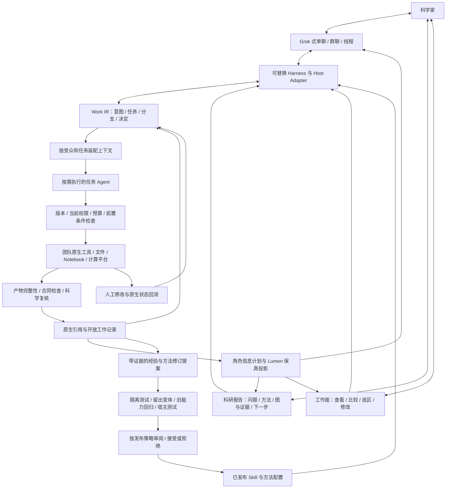

# AI4S Agent v3：复用科研协作基础设施的 Agent 框架

更新：2026-10-30。用途：统一产品方向、研发取舍与 MaSIF 下一阶段实现。

本版结合外部顶会、顶刊及顶级研究团队的一手工作，精修 [v2](AI4S_AGENT_FRAMEWORK_V2.md) 和 [MaSIF 详细设计](demo/masif/AI4S_DETAILED_DESIGN.md)。这是设计更新，不是新的后端部署或科研运行报告。研究筛选以 2026 年成果为主，保留少量直接相关的 2025 年正式论文；发表状态与工程报告分开标明。

## 0. 产品结论

我们要做的仍是原始 Lumen / AI4S Agent 的扩展：**让 Agent 进入科学家已经熟悉的工具、协作和表达机制中，接住具体工作，而不是要求人迁入一套全新的 Agent 世界。**

这里的“基础设施”不仅是 Git、Notebook、数据与计算平台，还包括群聊中的点名与交接、围绕图和证据的科研报告、提问与复核的习惯，以及由讨论形成下一步工作的方式。它们提供共同语境，不能被降格为后台流程外面的一层聊天皮肤。

产品要让用户自然经历三件事：

1. **按熟悉的方式协作。** 在群聊中委派和追问，围绕报告里的图讨论，在需要时进入方法和原始结果；不用先学会一套调度语言。
2. **讨论能继续变成工作。** 指向某张图、某个候选或某个解释的反馈，能成为有范围的修改、分支或下一步，而不是再手工搬运一次上下文。
3. **做过的工作能够积累。** 成果留在原生工具，有效方法沉淀为可验证 Skill，经验经过检查后复用；换模型或界面仍可接续。

对外可以这样解释：

> 在熟悉的群聊、科研报告和工具里，与 Agent 一起推进研究；结果看得懂，讨论接得上，工作留得住。

首个场景已经确定为 MaSIF 第 4、8、11、12 环节。团队已用 AI 跑出的探索成果、现有四节点交互 demo、尚待接通的新框架运行后端，是三件不同的事。我们不再退回选择泛化示例，也不把后端待集成误写成科研没有跑过。

## 1. 保留的原则与需要收紧的设计

### 1.1 同时复用三种基础设施

**工具与产物基础设施。** Git、Notebook、结构与数据目录、计算平台、身份和权限系统承载各自的权威记录。Work IR 连接这些记录，不复制出另一套必须依赖产品才能读取的科研事实。人的原生修改必须能反向进入框架。

**协作基础设施。** 复用群聊、线程、点名、回应、交接、提出异议和形成决定的约定。Agent 参加这些关系，但不能用模仿人的闲聊代替实际交付；讨论中的承诺须能定位到工作，权限仍归真实主体及既有制度。

**表达与认知基础设施。** 以用户提出的生物院系科研报告方式为参照，围绕研究问题、方法、关键图、证据、解释、局限与下一步组织交流。我们复用的是帮助人理解和质疑研究的结构，不是只生成一份像报告的排版。具体顺序、术语与详略由团队习惯决定，不假设所有院系有同一模板。

这三个方面共同构成产品，不能把后两者当成第一者的宣传界面。接入某款聊天软件、PPT 编辑器或 ELN 是实现选择；复用协作与报告的约定并不依赖已经接通某一个品牌。

### 1.2 复用协作机制，不等于模拟科研组织

**角色与群聊继续是重要 HCI。** 分析、可视化、流程角色是人可寻址的职责入口，不是模拟研究组职级，也不是必须常驻的三个模型进程。后台执行拓扑按任务依赖、隔离需要和预算选择。

**Lumen 继续负责多级可读性。** Signal / Summary / Workbench / Analysis / Source 共用对象和版本。角色组织语义；确定性检查守住来源、受众、关键限制和下钻。展开信息不是执行授权。

因此，“不模拟研究组”绝不意味着去掉群聊、报告和角色。我们保留人已有的理解与协作方式，去掉为拟人表演而设置的组织架构。谁维护结果、怎样追问、如何交接，要由真实工作关系决定。

### 1.3 新的 AI-native 能力发生在这些机制之间

Agent 自动维护群聊、报告、图和原生产物之间的对应关系；将自然语言与图上选区转成明确的工作变更；按对象和受众组织信息层级；并在讨论改变目标后更新依赖、执行和交付。

人与人协作中需要大量手工完成的上下文搬运、图文同步和方法接续，可以自动化。新意在这些连接与转换，而不在重新发明群聊、报告、Git 或科研职级。

**弱黑箱继续以外显工作为边界。** 实际输入、变换、产物、决定、未决效果与接续状态可查；不要求披露模型私有推理。引用存在不等于结论成立，哈希匹配不等于科学正确，模型自检不等于验收。

Skill、Harness、Work IR 与验证机制都是上述哲学的实现支撑，不取代产品主张。它们需要收紧的地方是：方法可执行可验证，参考轨迹不锁死新探索，经验更新不污染当前运行，评测同时覆盖工作正确性与协作是否顺畅。

## 2. 外部高质量工作怎样改变我们的设计

以下先陈述来源支持的机制，再给出我们的设计取舍。取舍属于针对本产品的推论，不表示论文已经证明它在 MaSIF 中有效。这里不做新颖性排名，也不把不同论文的分数横向拼接。

### 2.1 Paper2Agent：先把已有方法做成可执行、可验证资产

**Nature，2026-09-16。** Paper2Agent 从论文及代码出发，执行参考教程，提取参数化工具，测试后接入 Agent。论文也指出：复现参考答案主要反映执行保真，不足以裁定开放分析的科学有效性。[论文与 Methods](https://www.nature.com/articles/s41586-026-11044-y)

**我们的取舍：** MaSIF 产品化先做“参考运行包 → 原生入口封装 → 原例与变体测试 → 方法包发布”。保留团队已跑通的脚本，不只把 Word 改写成 prompt。MCP 是可选连接方式，不是 Skill、权限或科学验证的同义词；论文中的测试容差不搬成我们的分子设计阈值。

### 2.2 Co-Scientist：支持有边界的探索，不把工作写死成单一路径

**Nature，2026-05-19。** Co-Scientist 将假设生成、评议、排序与修订组织成迭代过程，并保留专家介入及实验验证。其自动 Elo 排序不是独立科学真值，论文明确讨论了来源与验证局限。[论文](https://www.nature.com/articles/s41586-026-10644-y)

**我们的取舍：** 在现有任务与产物关系中增加明确的探索分支，记录“要区分什么假设、要补什么证据、何时停止”。不照搬六种角色，也不以群聊共识或统一总分取代位点、结构和实验依据。

### 2.3 ACE：经验增量维护，不能靠反复重写大摘要

**ICLR 2026 主会 Poster。** ACE 将上下文组织为可增量更新的条目，通过生成、反思、整理积累策略；其效果仍依赖反思质量，并非所有任务都需要更长上下文。[会议记录](https://iclr.cc/virtual/2026/poster/10008343)；[方法与局限](https://arxiv.org/html/2510.04618v1)

**我们的取舍：** 将运行事实、待验证经验和已发布 Skill 分开存放。经验带来源、适用条件、反例和修订历史；按任务检索，而不是把整个群聊不断浓缩成唯一记忆。我们额外要求发布门禁和旧能力回归，这不是 ACE 对生产可靠性的保证。

### 2.4 AgentSuite：验收条件也需要被审查

**ICML 2026，正式 PMLR 论文。** AgentSuite / COBA 从 User、Environment、Ground Truth、Evaluation 四个部分检查基准问题，区分 Agent 失误和测试条件自身的缺陷。[论文](https://proceedings.mlr.press/v306/suh26a.html)

**我们的取舍：** 每个 MaSIF fixture 同时审查任务要求、输入与环境、参考依据、判定规则。模型生成新测试可以作为提案，但不能为了让自己的输出通过而同步放宽发布门槛。负结果、合理拒绝和证据不足也可以是正确交付。

### 2.5 MAST：把失败定位到合同、交接和验证

**NeurIPS 2025 主会 Datasets and Benchmarks Track。** MAST 对多 Agent 轨迹中的系统设计、Agent 间不一致和任务验证问题进行分类；它并不证明给每个任务增加讨论或复核角色就能解决失败。[正式论文入口](https://proceedings.neurips.cc/paper_files/paper/2025/hash/b1041e52d3be19f0a9bc491657488e4a-Abstract-Datasets_and_Benchmarks_Track.html)

**我们的取舍：** 交接必须有输入版本、预期产物、接收确认与验证结果。失败先区分环境、协议、方法、产物、交接和展示问题，再决定重试、修 Skill 或请求人工判断，不统一归因于模型不够强。

### 2.6 CollabLLM：协作是否有效，要看整个任务

**ICML 2025，正式 PMLR 论文。** CollabLLM 关注多轮协作的长期贡献，而不是只优化下一条回复，并通过任务评价和用户研究考察协作效果。[论文](https://proceedings.mlr.press/v267/wu25i.html)

**我们的取舍：** Lumen 的验收加入“用户是否正确理解当前结果、是否能改对范围、介入后是否减少返工”。更少的消息、更短的摘要或更频繁的主动提醒，都不单独代表更好的协作。暂不把训练专用协作模型列为产品前置条件。

### 2.7 Data Formulator 2：图形操作与语言共同表达意图

**CHI 2025 正式论文。** Data Formulator 2 结合图形界面、自然语言与迭代历史，使用户逐步表达分析需求，而不是一次写完完整提示。[作者机构论文页](https://www.microsoft.com/en-us/research/publication/data-formulator-2-iteratively-creating-rich-visualizations-with-ai/)

**我们的取舍：** 科研报告里的图不是回答终点。用户可指向图、候选或选区追问，再回到同一工作对象做比较或修改。这是对我们混合交互的设计启发，不意味着图表研究已验证了分子结构界面的全部交互。

### 2.8 工程与概念补充：与正式论文分层使用

- **Microsoft Research，2026-05-21，MagenticLite 官方工程介绍。** 延续聊天、原生操作、人工接管与关键动作确认的组合。[原文](https://www.microsoft.com/en-us/research/blog/magenticlite-magenticbrain-fara1-5-an-agentic-experience-optimized-for-small-models/) 我们借鉴协作入口与真实工具连续的体验，不因它使用小模型就预定我们的模型或后端。
- **Microsoft Research，2025-06，概念预印本。** Interaction–Process–Infrastructure 将可检查、可修改的工作过程放在交互与底座之间。[作者机构页面](https://www.microsoft.com/en-us/research/publication/interaction-process-infrastructure-a-unified-framework-for-human-agent-collaboration/) 它与已有思路相关，但当前页面标为 Preprint，不能标成 CHI 主会成果；更不能据此把我们的“基础设施”重新缩窄为技术底座。
- **Google Research，2026-10-16，官方研究介绍。** VERID 强调命令要结合实时环境状态检查，并记录执行与恢复。[原文](https://research.google/blog/grounding-ai-agents-in-biological-reality-building-blocks-for-autonomous-wet-labs/) 我们借用“执行前读取当前事实、执行后检查实际状态”的原则；不据此扩展到湿实验自动控制，也不把这篇介绍当作顶会发表证明。
- **Google Research，2026-01-28，研究报告解读。** 受控实验说明多 Agent 的收益与任务可并行性、工具负担和协调方式有关。[原文](https://research.google/blog/towards-a-science-of-scaling-agent-systems-when-and-why-agent-systems-work/) 我们采用按依赖和预算选拓扑的方案，不移植其中的数值阈值。
- **OpenAI 官方工程文档，核查于 2026-10-30。** 工具直测、独立模型循环与真实产品 Harness 测试覆盖不同问题。[Harness-aware evaluation](https://developers.openai.com/cookbook/examples/partners/harness_aware_plugin_evals/harness_aware_plugin_evals) 我们将宿主内端到端测试列为接入要求；工具测试通过不能代替用户实际入口测试。

未评审预印本可以保留为线索，但不作为本版主结论的主要依据；工程博客、Workshop 和主会论文不混标。Nature 对 The AI Scientist 的研究还明确区分了自动生成论文的 Workshop 通过与主会质量，不能用前者包装后者。[相关研究及局限](https://www.nature.com/articles/s41586-026-10265-5)

## 3. 统一架构：熟悉的协作表面连接真实工作

下面是本版目标设计，不是当前已部署组件清单。图中方框是职责接口，不要求拆成独立服务。

群聊提供共同语境，报告组织问题与证据，工作面承接直接操作；三者围绕同一工作对象往返，不是三个各自维护事实的应用。

其下的**工作闭环**使用已绑定的方法版本完成当前任务；**方法改进闭环**利用运行证据产生候选修订，通过测试和发布规则后才影响后续任务。运行中的任务不静默切换 Skill、验证器或模型配置。

Grok Bot Chat 仍是希望借用的交互范式，Harness 仍优先复用；但特定宿主的公开接入能力须单独核验。新论文没有补足 Grok 接口的证据缺口。没有接口时先采用可验证的 Host Adapter，不把本产品绑定到某份重建源码分析。

## 4. Skill 是方法包，Work IR 是一次工作的合同

### 4.1 三件事不再混用

**SkillDefinition**描述何时适用、如何调用、输入输出类型、检查与恢复方法。它可以包含 `SKILL.md`、脚本、类型定义、参考资料和测试，但本文的领域合同不是对某个通用 Skill 标准的接口承诺。

**TaskContract / RunManifest**绑定这一轮的目标、精确输入、方法与环境版本、预算、验收规则和实际运行标识。通用 Skill 不写死某一轮候选或批准。

**Native Adapter**负责真实工具调用、状态查询、取消与产物读取。文本规程不授予工具权限，不提供幂等性，也不能代替 adapter 的强制检查。

### 4.2 从团队成果固化方法的最短路径

1. 取一份团队认可的参考运行：输入、脚本、环境、参数、输出、人工选择和已知失败。
2. 包装现有入口，消除只对某个本地路径或固定对象成立的隐含假设。
3. 在原例上核对执行与产物；在变体上检查参数是否真正生效、错误输入是否正确停下。
4. 在实际 Harness 中检查调用、权限、异步状态、回传和 Lumen 对象版本。
5. 发布有适用范围的版本；保留旧版本和回归样例，不直接覆盖。

每个方法必须回答：何时不该使用？缺什么要问人？什么情况应直接调用原生工具？什么结果能证明交付成立？失败后该查询、重试还是停止？

### 4.3 经验不是新的事实库

运行回执和原件是事实；从它们总结的经验是候选知识；通过验证发布的 Skill 是方法。三者共享引用但不互相覆盖。

经验条目至少保存来源运行、观察、适用条件、待检验解释、反例、提议修改和验证状态。不得保存凭据或越权内容，不从单聊把私有资料隐式提升为群体记忆。未经验证的经验可以帮助提出问题，不能默默改变计算规则或批准范围。

第一版只做离线、可审阅的方法修订。模型参数自训练、递归自改进和自动改写生产评测器不进入本轮产品承诺。

## 5. 稳定执行与开放探索共用控制边界

### 5.1 稳定执行不是模仿旧对话

参考轨迹用于比较输入绑定、必要判断、实际变换、输出类型、验证和恢复。任务成功不要求复现相同措辞或随机候选排序，也不要求每次得到同一个科研结论。

只复现旧答案可能奖励硬编码；只要求完成流程可能忽略错误产物。因此同时检查合同是否满足、产物是否有效，以及偏离参考轨迹的理由是否有证据。

### 5.2 探索分支必须可定位、可比较、可停止

当原方法不适用或出现证据冲突，Agent 可以提出分支。分支记录父任务、待区分的问题、固定条件、拟变更项、所需证据、资源上限、停止条件和采用依据。

分支在原批准范围内可按策略推进；改变目标、方法边界、输入范围、预算或外部效果时重新检查授权。分支成功也不会自动替换正式方法。被否定的方案仍可作为有价值的研究产物保留。

用户在原生工具中改了文件，系统先比较版本及依赖：显示变化更新 view，方法变化产生新 revision；确实受影响的下游标为待复核。无法判断影响范围时先隔离不确定性，不用缓存覆盖人工修改。

### 5.3 不把所有结果压成一个“完成”

分别记录：工具执行状态、产物检查结果、科学复核结论、交付状态。一次正确发现候选不符合设计目的，可以是成功完成复核任务；它不是一个成功的 binder。证据不足时，正确输出可以是待补事项而非强行给结论。

## 6. 把群聊与科研报告真正做成工作接口

### 6.1 群聊复用的是协作规约

角色负责对象与信息，不绑定后台 Agent 数量。独立候选分析可并行，强顺序依赖按次序推进；具有实质风险或歧义的结果可增加独立检查，但不能因换了角色名就声称证据独立。

点名确定工作或信息责任入口；回复与引用确定正在讨论哪个对象；线程保留一个问题的协作语境；交接说明已有产物、未决事项和接手条件。群里主要出现有用的回应、关键变化和交付，不为了显得像团队而广播后台自言自语。

聊天消息并非都要强制转成任务。普通讨论保持为讨论；形成工作变更或决定时，才关联具体对象、范围和责任。明确的自然语言指令也可以成为批准的输入，不强迫人只靠一个专用按钮授权，但必须核对真实权限和绑定范围。

### 6.2 科研报告是可追问的共同对象

以用户提出的院系报告形式为设计参照，一次研究更新默认按以下结构组织；这不是声称已经取得团队的正式模板：

1. **问题与本轮目标：** 我们正在回答什么，和上一轮有什么关系。
2. **方法与变化：** 用什么方法，这次改了什么，哪些条件保持不变。
3. **关键图与证据：** 选择能支撑讨论的结构图、比较或观察，关联真实产物和版本。
4. **解释与备选解释：** 观察到了什么，哪些是推断，有没有反例或未解释现象。
5. **局限与待讨论事项：** 哪些信息会改变判断，需要谁补充什么。
6. **下一步提案：** 准备做什么、为什么、影响范围及需要的决定。

报告由不同职责角色共同维护：分析角色组织论点、方法和反证，可视化角色维护图与图注，流程角色维护阶段变化和下一步。不是再设一个脱离执行记录的全局写稿 Agent。

报告的叙事顺序可以为人重新组织，但图、数字、结论和决定仍引用同一版本的工作对象。数据更新后，对应段落标为待更新或生成新版本；已分享的报告快照不被静默重写。静态导出的报告保持普通可读文件，不要求收件人安装本产品。

### 6.3 同一内容，在群聊、报告与工作面之间往返

一条群消息可以给出本轮变化并附报告入口；报告中的某张图可以展开到比较工作面；图上追问携带对象、版本和选区，回到相应角色；经确认的修改再进入执行。完成后回到原线程，并更新相应报告段落及图。

这正是原 Lumen“同一对象、多种投影”的延伸。报告不是把聊天记录拼接成文章，也不是独立于数据的一份漂亮结论。

### 6.4 多级信息对应阅读意图，而不是摘要长度

五级信息都保留当前对象版本、复核状态和会改变当前判断的限制。原始日志和完整方法按需展开。计划与结果分开，提案与批准分开，预测与实验分开；让主画面清爽不等于把关键冲突藏到 Source。

Signal 适合群里的进展提醒；Summary 支持快速听懂一轮报告；Workbench 让人操作和比较；Analysis 回答方法与反例；Source 回到原始工具。这是默认对应，不是把每个表面锁死在一个层级。信息由角色按问题组织，用户决定何时深入。

介入分成三类：查看与追问；调整展示；改变工作。前两者不自动触发计算。改变工作时先展示版本差异、影响范围及预计资源，再按当前权限推进。无法估计的成本写待估算，不伪装成精确数字。

## 7. 评测应验证哪种能力

### 7.1 四层验证，逐层增加真实性

- **工具层：** 确定性地检查参数绑定、输入输出、实际文件与状态变换。
- **任务层：** 检查方法适用性、拒绝条件、语义产物、异常和已知反例。
- **真实宿主层：** 从实际聊天入口走到原生执行与结果回传，检查上下文、工具装配、权限、中断和交付。
- **人机协作层：** 观察科学家能否识别冲突、修改正确对象、理解影响并继续工作；同时记录总成本和人的投入。

协作层还要专门验证报告闭环：用户能否从简报理解问题，沿图找到证据，用熟悉的追问表达修改，并在下一轮确认哪些内容变了。熟悉的外观只是起点，真正要测的是理解、控制与接续成本。

先审查 fixture 的要求、环境、参考依据与判定规则是否一致，再运行比较。调试集与留出集分离；反复用于调参的集合不再被称为未见测试。需要更新验证规则时单独版本化并重新比较，不与待验 Skill 合并成一次“自证通过”。

### 7.2 第一轮比较要回答具体产品问题

在相同输入、工具可用性、模型配置、计算预算和人工协助条件下，比较现有人工带跑方式、带方法包的执行、再加入角色/LOD 协作后的完整产品。条件不能同时控制时记录差异，不把整包收益归因于单一模块。

至少报告：按合同完成的任务比例、错误放行与错误阻断、关键证据可定位性、故障恢复结果、重复副作用、端到端耗时/资源和人工介入负担。任务分母、超时及无法判断的条目必须显式保留。重复运行不能充当独立科研对象；尚无数据的指标不填目标成绩。

模型评审可辅助归类和定位，但科学标准由领域团队确认，关键判断对照原生数据与独立检查。通过一个测试不构成完整科学结论。

## 8. MaSIF 如何承接这次精修

四节点、团队报告数字及候选来源口径保持不变，不修改科研算法或增添新阈值。

**N1 位点确认。** 将位点意图和结构版本绑定；未确认的功能目的不靠默认提示补齐。更换位点时明确生成分支或新修订。

**N2 设计边界。** 方法包检查 target、binder、motif 的可变范围及环境配置；固定 target 序列与固定骨架继续分别表达。执行前再次读取当前输入与授权。

**N3 母体选择。** 把候选、来源谱系、筛选依据和选择理由变成可读回的产物；比较规则变更时展示集合差异及受影响下游。“633 个候选来自 3 个 seed”仍是团队报告事实，不据此生成未知来源占比。

**N4 AF3 复核。** 将已有预测输出、设计位点和检查结果一起呈现；置信度不能覆盖位点冲突。补算先形成有停止条件的提案；source seed、model seed 和实验验证继续分开。

### 建议下一步先实现 N3 的可追问报告闭环

这是工程优先级建议，不改变四节点产品故事。N3 可先利用已有计算产物验证核心合同与协作，而无需把新的高成本作业提交作为第一道依赖。

第一轮需要 running 团队交付：一份可共享的真实候选集合及列定义、相应结构和来源映射、现有选择脚本/配置、一次人工选择及理由。若先给子集，就明确测试子集，不能将其验收外推为全部 633 条。若有团队惯用的一页报告或脱敏讨论样例，可据此校准表达与交接方式；没有时先采用 §6 的可调整结构。

最小验收故事是：导入真实集合 → 在群里交付一轮含问题和证据的报告 → 用户围绕图追问并修改选择 → 原生保存 → 更新报告和原线程 → 重启恢复 → 在原生工具改一次文件 → 回流并标记受影响图和结论。随后接入 N4 的已有结果复核，再验证一个真实异步作业的未知结果、取消与恢复。

例如，“候选很多，但来源有限”是本轮报告要解释的问题；“按来源和结构假设比较，不只看总数”是用户的讨论输入。系统应把它关联到当前候选和分析方法，提出具体比较或选择变更，不能凭一句话伪造新的来源分布。这里展示的是协作如何承接工作，而不是多几个 Agent 在群里发言。

这轮报告的最小内容可以是：问题是母体集合是否足够丰富；现有观察是团队报告中的 633 个候选来自 3 个 seed；解释是数量不能直接代表独立方案数；待讨论的是如何平衡来源、结构差异和预算；下一步是基于真实谱系提出选择方案。每一项都能被追问，缺失的比例和结构信息不靠文字补齐。这是报告交互的设计示例，不是一次新增科研运行。

仅有报告汇总时，可以完成合同和 UI fixture 测试，但不能声称验证了真实逐候选筛选。材料缺口是集成输入缺口，不是否认团队已有成果。

## 9. 实施顺序与暂不建设的内容

**P0：一轮真实协作闭环。** 绑定参考运行包、锁定方法与环境、实现一个原生 adapter、独立产物检查、群聊与报告的同版本 Lumen 呈现及人工修改回流。先通过报告理解、图上追问、正确修改、证据不足和恢复等完整故事。

**P1：受控探索与异步可靠性。** 补分支比较、范围变更、预算约束、unknown 查询恢复和交付重试；用真实宿主而非独立脚本验收。

**P2：方法积累。** 从真实失败提出局部修订，在隔离环境验证迁移与旧能力保持，再发布并保留回退路径。没有 P0 的可靠证据，不先建设自动经验工厂。

暂不建设：另一套通用 Harness、按工具拟人化的常驻组织、全域私有知识库、自动训练/RSI 平台、湿实验自动控制，以及以生成论文为目标的流水线。也不为架构图中的每个方框建立新服务。

验收标准是用户能正确完成并继续工作，不是角色数量、Skill 数量、对话长度或产出报告数量。

## 10. 当前文档与交付状态

- **产品决策入口：** 本文。
- **实现合同与详细流程：** [AI4S 详细技术设计 v0.4](demo/masif/AI4S_DETAILED_DESIGN.md)。
- **现有演示：** [三分钟介绍](demo/masif/00_DEMO_INTRO.md)、[四节点案例](demo/masif/03_MASIF_DEMO_CASE.md)、[页面](demo/masif/app/index.html)。
- **历史推导：** [v2](AI4S_AGENT_FRAMEWORK_V2.md)、[基础设施原生架构 v1.1](INFRASTRUCTURE_NATIVE_AGENT_ARCHITECTURE.md)。
- **接续入口：** [CONTEXT_HANDOFF.md](CONTEXT_HANDOFF.md)。

本次更新设计及文档索引；未修改演示程序、科研数据、方法脚本或模型配置，未执行科学计算。9 月的图片和 ZIP 保留为原展示版本，不作为本版新增机制已经实现的证明。
