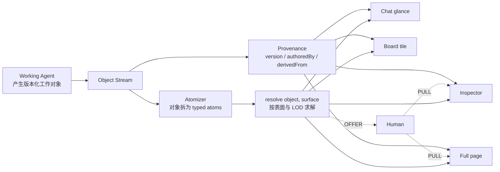
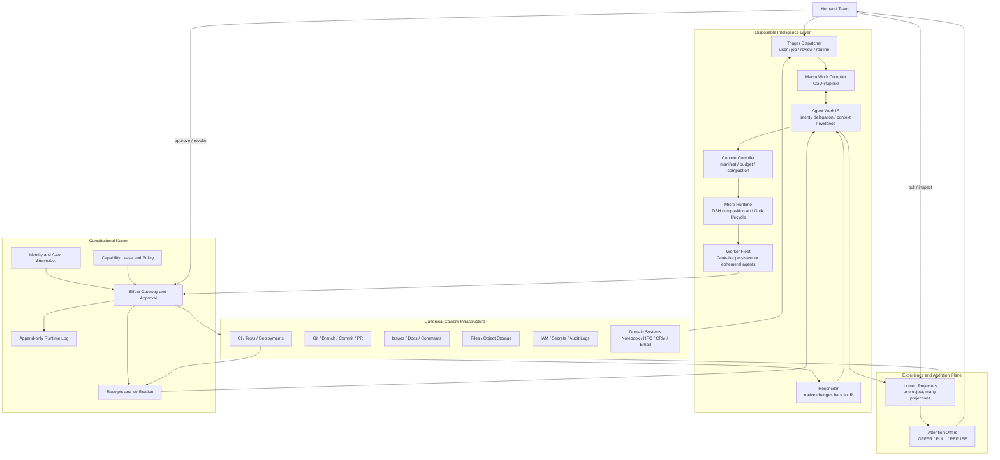
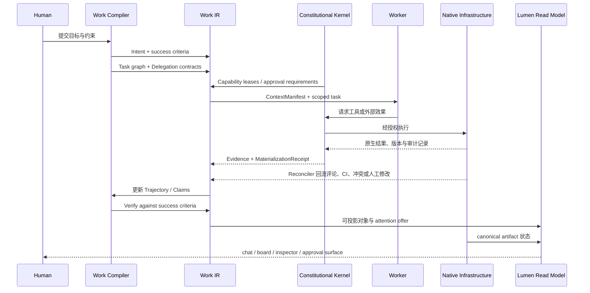
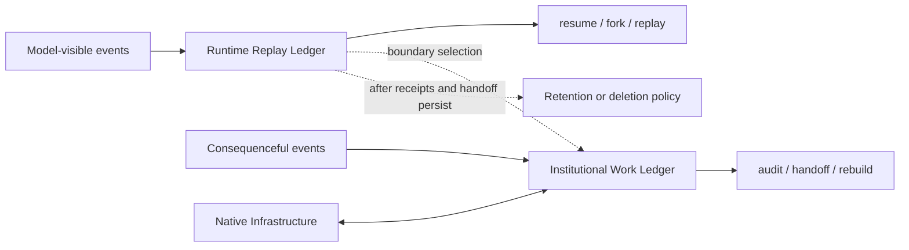

# 基础设施原生 Agent 架构

> 历史架构背景。2026-10-30 起，产品与实施优先级以 [AI4S Agent v3](AI4S_AGENT_FRAMEWORK_V3.md) 和 [详细设计 v0.4](demo/masif/AI4S_DETAILED_DESIGN.md) 为准。本文件保留旧原型分析和原始推导，不作为当前功能清单。

> 从此前的 Lumen 可读性原型，演进到以 Agent Work IR 为中介、以既有协作基础设施为事实底座的可删除智能层

- 文档状态：Architecture Summary v1.1
- 初版日期：2026-08-22
- 本次更新：2026-09-10，纳入 Grok Bot 0.18.0 Harness 材料、上下文接续与新版产品方向
- 当前产品基线：[AI4S Agent v3](AI4S_AGENT_FRAMEWORK_V3.md)；[v2](AI4S_AGENT_FRAMEWORK_V2.md) 保留为历史设计
- 适用读者：产品、架构、工程与设计团队
- 文档性质：统一思想与目标架构说明；其中“此前 Agent”描述现有原型，“目标 Agent”描述拟建设系统，二者不能混同为已实现能力

---

## 0. 执行摘要

我们要构建的不是一个新的 AI IDE、Git 替代品或封闭的“Agent 操作系统”。它更接近一层**可替换、可删除、但具备长期工作能力的智能执行层**：Agent 在人类长期演进出的协作基础设施中工作，把关键状态、授权、证据和结果交还给这些基础设施。

一句话定义：

> **Agents come and go. The work stays in your tools.**  
> Agent 可以来去，工作必须留在人的工具、制度与记录中。

这意味着：

1. 文件、Git、IDE、Issue、PR、CI、IAM、日志、Notebook、HPC、CRM 等仍是组织事实与治理边界。
2. Agent Work IR 不是新的事实数据库，而是连接意图、委派、上下文、权限、轨迹、证据和产物的公共中间表示。
3. IR 必须能够向既有基础设施物化，也必须能够从既有基础设施反向重建；只有单向导出，不算基础设施原生。
4. Agent 可以持有持久运行日志，但关键工作状态不能只有产品私有的一份。关键状态的 Shadow State Budget 目标为 0；删除运行时须先满足关键记录已物化、未决副作用可接管的条件。
5. 此前完成的 Lumen 原型不应被放弃。它最有价值的部分——对象化呈现、同一对象多种投影、来源可见、OFFER/PULL 注意力契约——应成为目标系统的**可读性与注意力平面**。

统一后的架构可以概括为：

> **既有基础设施承载权威记录；Work IR 表达工作；GSD 启发宏观编排；DSH 启发可组合运行时；Grok Bot 同时启发长期 Worker 和运行约束；Lumen 负责人的信息投影；Context Compiler 负责模型的上下文投影；Claude Science 提供垂直领域参考。**

### 0.1 本版材料与证据边界

新材料为用户提供的《Grok Bot 0.18 的 Agent Harness 设计》，已原样归档为 [Grok Bot 0.18 静态分析](sources/grok-bot-0.18-harness-static-analysis.md)。它自述基于**重建源码的静态分析，未运行验证**；本文没有取得其引用的源码仓库、构建产物或服务端分类器。

因此本文区分三种陈述：材料报告的机制、由机制推导的设计启发、我们的目标设计。源码路径及行号属于材料内引用，不能表述为本轮亲自复核过的源码证据。0.18.0 是材料标注的版本，本文不据此推定发布日期或目前线上版本。

材料开头将分析对象标为 Anysphere / Cursor、内部代号 `sand`；此前产品参照来自 x.ai 页面。本文未建立该重建代码与公开产品构建版本的同源证明，二者分别作为实现线索和产品参照，不能相互补齐未证实的事实。

原文 SHA-256：`0f8f646781f316932554e9d15ee71df991039e6399fc502ff76ee1c806b49ed7`。归档保留原文判断；本文在 §9.3 中记录必要的证据修正。

本轮更新集中在运行时、Work IR、上下文/记忆、权限和验证，不是只给参考资料增加一条链接。架构与 schema 仍是设计提案，未建设为可运行系统。后续会话入口见 [CONTEXT_HANDOFF.md](CONTEXT_HANDOFF.md)。

### 0.2 最新方向：按任务类型扩展原始 Agent

用户进一步澄清：不是构建模拟科研组织的“AI 研究组”。新版应以原始 Lumen/Agent 的对象化工作为基础，按可视化、数据分析等任务类型扩展能力，并使任务、产物和操作与对应基础设施对齐。Group 是任务委派和协作形成的执行关系，可以显式呈现，但不应成为拟人化组织架构。

Grok Bot 的交互与 Harness 是拟借用的上层工作入口和执行承载，用来简化、自动化工作流；我们新增的核心是领域工作契约、对象投影和弱黑箱可追溯性，而不是另一套通用 Agent 平台。直接接入 Grok 的接口可用性尚未得到证实。

[AI4S_AGENT_FRAMEWORK_V2.md](AI4S_AGENT_FRAMEWORK_V2.md) 是当前新版入口，并覆盖本文件中较早的 group/长期成员中心化推断以及 §11 的 coding-first 建议。角色与群聊仍是重要 HCI：它们是工作架构与人良好协作的接口，不是拟人组织的目标。各任务角色还负责管理结果的多级信息表达，确定性投影规则保留来源、版本与控制边界。

当前目标是构建、展示、打磨产品，而不是论证新颖性或发表论文。新版按完整用户工作流组织；本文件的比较材料仅作为设计依据，不再作为主线。

---

## 1. 文档中的两个 Agent

### 1.1 “此前完成的 Agent”：Lumen / landing-handoff

本文把 `/Users/a1/Downloads/landing-handoff` 中的项目称为 **Lumen 原型**。它的产品定位是 “the legibility layer for agentic work”，重点不是让 Agent 获得更多工具，而是让 Agent 产生的对象在不同表面上保持可读、可追溯且不滥用人的注意力。

它提出了以下核心设计：

- 一个 Working Agent 负责工作并产生对象；一个 Legibility Agent 负责对象如何出现在不同界面。
- 渲染管线是 `object → atoms → resolve(surface) → widget`。
- 同一个对象可以投影为 chat glance、board tile、inspector、full page，而不是复制成多个互相漂移的副本。
- 信息密度使用 LOD（signal / summary / workbench / analysis / source）调节。
- 当信息与表面不匹配时，系统显式采用 `VIRTUALIZE`、`OFFER` 或 `REFUSE_IN_PLACE`，不静默截断。
- Agent 只能 OFFER；人决定是否 PULL。注意力不是默认可被 Agent 占用的资源。
- provenance 必须“穿在像素上”：作者、版本、`derivedFrom` 等信息不应藏在二级审计页。

### 1.2 “我们的 Agent”：基础设施原生 Agent

本文把讨论中形成的目标系统暂称为 **Infrastructure-Native Agent（基础设施原生 Agent）**。

它的职责比 Lumen 更广：接收意图，规划和委派工作，装配上下文，申请有边界的能力，持续执行，生成可验证证据，并将结果物化到组织已有的协作基础设施中。同时，它必须允许 Lumen 式界面从这些记录中重建工作状态。

Lumen 与目标 Agent 不是互斥方案：

- Lumen 解决“工作如何被看见、理解和请求关注”；
- 目标 Agent 解决“工作如何被表达、执行、授权、验证和沉淀”；
- 前者成为后者的 Read Model 与 Attention Plane，而非另起一个封闭 Workspace。

---

## 2. 底层哲学：Fall Back to Infrastructure

### 2.1 既有基础设施不是历史包袱，而是制度记忆

Git 不只是文件版本工具，PR 不只是代码页面，Issue 不只是待办列表，CI 不只是自动化脚本。它们凝结了多人协作中长期形成的边界：

- 谁提出、谁批准、谁执行；
- 哪个版本进入生产；
- 什么可以回滚；
- 哪些检查必须通过；
- 冲突如何显式化；
- 责任、证据与时间如何关联。

因此，“重做 Git/IDE”经常不是技术创新，而是不小心重做一整套组织制度。我们的默认策略是复用这些制度，把 Agent 变成其中的新参与者。

### 2.2 打破轮子，不等于重复制作轮子

AI-native 的创新不应主要发生在存储、版本号、文件树、评论框和审批按钮上，而应发生在过去没有一等表达能力的**工作语义**上：

- 意图及成功条件；
- Agent 对 Agent 的委派合同；
- 一次推理实际使用了哪些上下文；
- 权限为何授予、何时失效；
- 长任务如何暂停、恢复、分叉和补偿；
- 结论由哪些证据支持，又会被什么新证据推翻；
- 不确定性、负面知识和语义冲突如何显式存在；
- 何时值得打断人，以及延迟处理的成本。

新的部分是这些语义及其运行时；成熟的部分继续落在 Git、Issue、CI、IAM、日志和领域工具上。

### 2.3 四条产品法则

1. **基础设施正典性（Infrastructure Canonicality）**  
   对已有事实类型，既有基础设施中的对象、版本、权限与结果是 canonical；Agent 只持有引用、投影与暂存状态。

2. **双向可编译（Bidirectional Compilation）**  
   Agent 能把高阶工作表达物化为原生对象，也能从外部发生的修改、评论、CI 结果和人工决策反向 reconcile 回 Work IR。

3. **关键状态必须越界物化（Boundary Materialization）**  
   委派、授权、外部副作用意图、关键决定、执行结果和验证证据不能只存在于模型上下文或私有数据库中。

4. **删除测试（Vanishing Product Test）**  
   删除 Agent 产品的运行时数据库、更换模型或关闭供应商后，团队仍应从原生基础设施恢复关键工作、责任、证据与最终产物。

### 2.4 两条运行时公理

> **Model-visible means logged.** 模型看到并据以行动的事实必须进入可重放日志。  
> **Consequenceful means materialized.** 会影响组织、外部系统或后续决策的事实必须物化到组织记录。

第一条支持输入与行动记录的恢复；第二条支持制度连续性。这里的 replay 指读取当时的模型可见输入、工具请求、结果和状态转移，并不保证另一个模型逐字复现同一推理或得出相同输出。供应商的隐藏状态可以作为恢复优化，但不能成为组织接管工作的必要前提。

### 2.5 两类投影与一个保留契约

Lumen 把工作对象投影到人的屏幕；Context Compiler 把工作对象投影到模型的有限上下文。二者都在做带预算的信息选择，应共享对象身份、版本、来源、不确定性和省略声明。

这种统一并不要求人和模型看到相同内容。屏幕关注可理解性与打断成本；模型输入还需要权限过滤、工具协议完整性、token 预算和稳定前缀。两者共用事实与保留契约，各自实现选择策略。

对人的 `object → atoms → surface` 和对模型的 `work state → context items → request`，都不能在压缩时把“候选方案”变成“已经批准”，或把“工具输出了一些内容”变成“副作用已经成功”。这给此前的可读性哲学提供了运行时延伸。

---

## 3. 此前 Lumen Agent 的架构

### 3.1 产品叙事中的架构



该模型的原创价值在于：Working Agent 无权自行决定人的屏幕如何被占用；呈现是一个独立的、确定性的治理问题。一个对象的不同视图必须共享身份和来源，显示空间不足也不能成为隐瞒信息的理由。

### 3.2 原型中的真实组件

现有实现是一个静态 HTML/CSS/vanilla JavaScript 产品原型，核心路径主要位于 `app.html`：

1. **Payload / Object 集合**  
   `payload.sample.json` 或页面内嵌数据提供 process、results、report、comparison、decision 等演示对象。

2. **Atomizers**  
   按对象 kind 将内容拆成 claim、status、provenance 等 typed atoms。

3. **Resolver 与 Renderers**  
   `resolveAtoms` 根据 LOD 过滤 atoms；不同 renderer 把结果呈现在 chat、board、inspector、page 等表面。

4. **Fit / Overflow 行为**  
   `ResizeObserver`、`fitPlan()` 和若干专门 watcher 处理尺寸变化、溢出与 REFUSE/OFFER 演示。

5. **View State**  
   tabs、pins、messages、decisions 等交互状态主要保存在浏览器内存，只有 rail 宽度使用 `localStorage`。

6. **Provenance 元数据**  
   UI 展示 `AUTHORED · AGENT`、版本与 `derivedFrom` chips，但这些值来自 payload，并未经过签名、主体认证或内容哈希验证。

### 3.3 已经成立的能力

Lumen 原型已经较好地证明了以下产品概念：

- “同一对象、多种投影”比在聊天中复制内容更适合长期 Agent 工作；
- provenance 应直接出现在结果表面，而非只存在于后台日志；
- 信息密度和注意力需要明确协议，不能让 Agent 靠生成更长文本来抢占界面；
- 工作结果应该成为可定位、可引用、可进入下游关系的对象，而不是一次性消息；
- 可读性可以由独立 resolver 决定，为以后替换 UI 或增加新 surface 留出空间。

### 3.4 尚未成立的能力

为了不把产品叙事误认为运行时事实，现状边界必须明确：

- 没有真实模型调用、工具协议、Agent 调度或长期后台执行；所谓“双 Agent”目前是产品模型，不是两个独立运行实体。
- 没有真实 mounts、身份、RBAC、Capability Lease、凭据隔离、资源预算与外部副作用审批。
- 没有数据库、append-only event log 或可重放持久状态；刷新后大部分工作状态消失。
- “immutable, versioned objects”尚未实现为不可变历史；部分 demo 逻辑会原地修改对象和版本。
- `decide()` 不是所有渲染路径的统一政策入口；OFFER、fit、REFUSE 分散在不同实现中，存在旁路。
- provenance 是可伪造字段，不是可验证证据。
- 演示中的人工选择主要是显示保真度/溢出策略，不等同于对发信、支付、写数据库或提交计算任务的授权。

结论：此前项目是一个有明确哲学的**可读性与注意力治理原型**，不是完整 Agent 后端。这不是缺陷判断，而是目标架构中的正确定位。

---

## 4. 统一后的目标架构

### 4.1 总体结构



图中最重要的不是组件数量，而是箭头方向：

- Agent 通过 Effect Gateway 作用于基础设施，不能绕过原生权限与审计；
- 基础设施的外部变化通过 Reconciler 回流，因此 Agent 不垄断工作状态；
- Lumen 同时读取 IR 和 canonical artifacts，生成可丢弃、可重建的投影；
- Constitutional Kernel 约束所有 Worker 和插件，而不是由每个 Agent 自报权限。

### 4.2 八个逻辑层

#### L0：Canonical Cowork Infrastructure

包括文件系统、Git、Issue/PR、CI、IAM、日志以及领域基础设施。它们负责最终版本、访问控制、审查、部署、回滚和组织留痕。

原则：能用原生对象表达的事实，不在 Agent 私有数据库中再造第二份主记录。

#### L1：Infrastructure Adapters 与 Reconciler

Adapters 把统一动作映射为原生 API、CLI 或 UI 操作；Reconciler 监听或轮询外部变化，将原生对象的新版本、评论、审批、失败和冲突翻译回 Work IR。

每个 adapter 至少要定义：

- 原生对象的 canonical URI 与版本/哈希规则；
- 幂等键和重试语义；
- 所需权限与作用域；
- 成功、部分成功、失败与未知结果的判定；
- 验证查询与补偿/回滚策略；
- 原生冲突如何转换为 Semantic Conflict。

#### L2：Constitutional Kernel

Constitutional Kernel 表示一组不能被执行路径绕过的约束，负责接入既有身份、授权、副作用控制与审计。实现可以使用现有 IAM、操作系统 sandbox、组织策略引擎和替换后的 adapter；不可绕过的是约束，不必再创造一个独占的权限数据库或固定代码内核。模型、工具适配器、UI、memory provider 的替换必须继续满足这些约束：

- Actor 身份和发起链；
- Capability Lease 检查；
- 风险分级与审批；
- 预算、期限和可撤销性；
- 模型可见事件的 append-only 记录；
- 外部效果的 request / result / verify receipt；
- 按组织现有策略执行拒绝、审批和必要复核。

策略的最终授权来自用户/组织及基础设施的当前状态。模型生成的风险判断只能辅助分类，不能自行扩大权限；Context Compiler 缓存中的权限描述也不等于执行时的授权。

#### L3：Agent Work IR

IR 是高阶工作语义的公共语言。它连接人类意图、Agent 分工、运行时事件和原生产物，但不复制原生产物的全部内容。

IR 既是编译器的输入/输出，也是 Lumen Read Model 的数据契约。它应使用开放、可版本化的 schema，并可物化为 Git 中的 JSON/YAML、Issue/PR 元数据或组织的 append-only 审计记录，而不是只能由某个产品数据库解释。

#### L4：Macro Work Compiler

宏观编译器把模糊目标编译为可执行工作图，借鉴 GSD 的 Discuss → Plan → Execute → Verify → Ship 和 fresh-context subagents，但不强制所有领域使用同一套 ceremony。

它负责：

- 澄清目标、约束、成功条件和风险等级；
- 构建依赖图与并行 wave；
- 为任务分配 context budget、capability budget 和 cost budget；
- 生成 Delegation Contract 与 Return Contract；
- 在执行前验证计划，在执行后验证目标，而不只验证任务是否“做完”；
- 将关键计划与状态物化到 Issue、Git、项目文档或领域任务系统。

#### L5：Micro Runtime / Harness

微观运行时借鉴 DeepSeek Harness 的 evented、plugin-composed 设计：模型适配器、工具注册、session projection、sandbox、UI 和 provider 可按 profile 组合；turn / step / tool lifecycle 有明确拦截点。

它负责：

- Trigger → turn → step → tool call 的生命周期，区分真人请求与后台事件；
- Context Compiler 装配上下文、固定可缓存前缀并生成每次请求的 ContextManifest；
- 工具调用前后拦截；
- pause / resume / fork / cancel；
- 实时事件与 durable session event 的分离；
- 插件的作用域、装载和可逆卸载；
- DeliveryObligation 的记录、传递、有限重试和交付确认；
- ContextCheckpoint 的提交与恢复，以及后台完成事件的幂等处理。

本版将 Grok Bot 材料中的事件分发、交付义务和压缩周期纳入此层。Context Compiler 是运行时的子模块，与宏观 Work Compiler 分工：前者决定“这次模型请求看什么”，后者决定“整个任务怎么完成”。

DSH 启发可组合实现；本系统另要求所有 provider 持续服从同一执行约束。阶段工具或 Reflect 可以提出规划/执行切换与进度反思，但状态转换仍由运行时校验；固定步数提醒是待评估策略，不能替代成本预算和停机条件。

#### L6：Worker Fleet

Worker 可以是短命的 fresh-context executor，也可以是 Grok Bot 式长期、命名、可运行 routine 的数字同事。它们的持续性是体验与调度策略，不是组织事实的唯一位置。

Worker 必须通过 Delegation Contract 获得目标，通过 Context Manifest 获得最小必要上下文，通过 Capability Lease 获得最小权限，并以 ArtifactRef、Evidence、Claim 和 Receipt 返回结果。

#### L7：Legibility / Attention Plane

这是此前 Lumen 的演进位置。它不拥有工作，只投影工作；不决定外部效果是否被授权，只决定信息如何忠实地到达不同表面以及何时请求人的注意力。

呈现与执行共用对象、来源和策略版本，但需要两个明确的执行入口：

```text
projectionPolicy.evaluate(object, surface, audience, disclosure)
  -> projection | offer | refuse

effectPolicy.evaluate(actor, lease, effect, currentPolicy)
  -> allow | deny | requireApproval
```

所有 chat、board、inspector、notification 和 approval surface 都经过呈现检查；任何真实副作用，包括用户点了批准卡之后，都必须重新经过执行检查。PULL 表示展开查看，不等于 APPROVE；可读性服务不能授予执行权限。

同样的 Work IR 可由 Context Compiler 生成模型输入。两个 projector 共享“哪些字段不能被省略”的契约，而不是共用一个万能 resolver。

---

## 5. Agent Work IR

### 5.1 统一信封

所有 IR 对象共享一个最小信封：

```yaml
apiVersion: work.agent/v1
kind: ContextManifest # 示意；其他 kind 见 §5.2–5.4
metadata:
  id: globally-unique-id
  version: 3
  createdAt: 2026-08-22T10:00:00+08:00
  createdBy: actor://org/team/agent-17
  derivedFrom: []
  canonicalRefs: []
  contentHash: sha256:...
spec: {}
status: {}
```

约束：

- 版本更新是 append-only 新事件或新对象版本，不能原地覆盖历史。
- `canonicalRefs` 指向原生对象及其观察版本；IR 不把大型文件、PR 内容或 Notebook 全量复制成自己的孤岛。
- `createdBy` 必须解析到经过 attestation 的 Actor，而不是任意字符串。
- `derivedFrom` 是可验证图边，至少绑定对象 ID、版本和哈希。
- schema evolution 必须显式版本化并提供迁移/兼容策略。

### 5.2 核心类型

#### Intent：做什么，以及何谓成功

关键字段：目标、约束、非目标、success criteria、risk class、owner、deadline、external refs。

Intent 不等于 prompt。Prompt 是一次模型请求；Intent 是跨模型、跨会话、跨 Worker 保持稳定的工作合同。

#### Actor：谁在行动

关键字段：principal ID、human/agent/service 类型、模型与 provider、父 Actor、组织/租户、trust domain、attestation。

Actor 解决“AUTHORED · AGENT 具体是哪一个 Agent、代表谁、在什么版本和权限下行动”。

#### Delegation：为什么把哪部分工作交给谁

关键字段：parent、delegatee、scope、budget、deadline、return contract、allowed subdelegation、revocation ref。

委派不是一句“你去做”。Return Contract 应明确要求返回哪些 claims、evidence、artifacts、测试结果和未解决风险。

#### ContextManifest：这次推理实际看了什么

关键字段：source refs、版本/哈希、选择原因、freshness、sensitivity、token budget、omitted context。新增建议字段：audience、trust domain、purpose、retention class、context epoch、source revision、policy revision、prompt/toolset digest、must-preserve IDs 和实际请求项的来源映射。

它让 context engineering 从隐式 prompt 拼接变成可审计输入，也允许相同 Intent 在不同 ContextManifest 下进行对照或恢复。传给模型的是一个经过用途与受众过滤的投影；Manifest 必须能说明被省略了什么、什么可能已过期，以及如何回到原始证据。

#### CapabilityLease：被允许做什么

关键字段：actions、resources、constraints、expiry、max cost、risk ceiling、delegable、approval ref、revocation ref。新增建议：execution surface（sandbox / host / remote）、principal/account、policy revision、tool descriptor digest；换执行面或身份不得沿用原批准。

Lease 是临时、窄范围、可撤销的权力，不是把人的完整登录态永久交给 Agent。

#### Trajectory：工作如何推进

关键字段：run ID、state、checkpoints、branches、wait reason、retry policy、compensation、parent/child runs。

Trajectory 使长任务可暂停、恢复、分叉和追责；它不要求保存私有 chain-of-thought，只保存行动所需的状态转移、输入、输出与理由摘要。

#### Claim 与 Evidence：结论及其依据

Claim 记录 statement、scope、confidence、invalidators 和 evidence refs；Evidence 记录观察、工具结果、hash、actor、time、verification status。

二者分离很重要：一份测试输出是 Evidence，“该版本满足性能目标”是 Claim。新 Evidence 可以强化或推翻 Claim，而无需重写历史。

#### ArtifactRef：成果在哪里

关键字段：canonical URI、版本/哈希、media type、derivedFrom、materialization status、owner、retention policy。

ArtifactRef 的目标是让结果留在 Git、对象存储、文档系统或领域基础设施中；Agent 只保留可解析引用与必要摘要。

#### AttentionOffer：何时值得打断人

关键字段：urgency、requested surface、why now、decision required、cost of delay、fallback link、expires at。

它把 Lumen 的 OFFER/PULL 从 UI 技巧提升为可记录协议。没有明确决策需求的状态更新默认进入可拉取 surface，而不是主动抢屏。

### 5.3 可选但重要的扩展类型

- **SemanticConflict**：不只表示文本冲突，还表示两个 Intent、Claim、Policy 或 Artifact 语义上无法同时成立。
- **UncertaintyState**：记录未知项、置信边界、需要什么证据才能收敛。
- **NegativeKnowledge**：记录已经验证无效的方法、失败前提和不要重复的路径。
- **SkillPackage**：可复用工作方式，包括适用条件、输入契约、能力需求、验证方式与版本，而不只是 prompt 模板。
- **MaterializationReceipt**：记录 IR 动作如何变成原生对象，以及如何验证已生效。

### 5.4 本版增加的运行契约

以下名称是我们的 schema 提案，不是 Grok Bot 已公开实现的协议。首版可以先实现为带类型的事件与校验器；暂不需要把每个概念都建成独立服务。

**TriggerEnvelope：什么唤醒了工作。** 保存 `eventId / kind / issuer / causedBy / intentRef / receivedAt / authorityRef / dedupeKey`。真人请求、例行任务、子 Agent 返回、CI 结果和系统提醒分别标记来源；后台通知不能因被渲染成 user message 就获得新的用户授权。

**DeliveryObligation：谁还在等待哪种交付。** 保存 `requestRef / recipient / requiredArtifactRefs / duePolicy / state / deliveryReceiptRef`。状态至少区分 waiting、ready、sent、failed；进度回复可以满足一个回应要求，但不能把任务标为完成。客户端/API 报告已送达，也不等于用户已读或验收通过。

**ContextCheckpoint：压缩后靠什么接续。** 保存 `intentRevision / eventWatermark / preservedControlRefs / evidenceRefs / pendingEffects / pendingDeliveries / nextActions / unresolvedQuestions / contextEpoch / backend / digest`。可附加供应商专属 resume token，但可读字段与外部引用必须足以在没有该 token 时接管工作。

**MemoryProposal：哪些经验值得进入长期记忆。** 建议以 Claim + Evidence + 变更事件组合表达 `create/update/remove`，带 `sourceEvidenceIds / origin / scope / audience / baseRevision / reviewerResult`。将可验证证据升级为组织事实仍走原生记录；偏好缓存和推断不自动升级为授权。

这些新增契约有共同目的：让 turn 结束、模型切换、上下文压缩、会话恢复和离线记忆更新，都有可检验的前置条件与后置条件。

---

## 6. 编译、执行与回流

### 6.1 端到端生命周期



### 6.2 效果阶梯

此前 Lumen 主要治理“能否占用人的显示空间”。目标系统把同一思想扩展为行动治理：

```text
READ → DRAFT → PROPOSE → APPROVE → EXECUTE → VERIFY → ROLLBACK / COMPENSATE
```

- **READ**：读取经 lease 授权的最小上下文。
- **DRAFT**：在 sandbox、分支或草稿对象中产生无外部影响的候选结果。
- **PROPOSE**：展示 diff、证据、风险、成本与预期效果。
- **APPROVE**：由政策或人对具体 effect、具体版本和具体期限授权。
- **EXECUTE**：通过 adapter 调用原生系统。
- **VERIFY**：重新读取原生系统，证明效果实际发生且符合预期。
- **ROLLBACK / COMPENSATE**：能回滚则回滚；不可回滚时执行明确补偿，并保留失败记录。

审批绑定 effect digest，而不是笼统绑定整个会话。提案内容、目标对象或风险条件变化后，旧批准自动失效。

### 6.3 双向编译

#### IR → Native：Materialize

示例：

- Intent → Issue / project brief；
- Delegation → assignee、任务子项或签名的 work record；
- Draft artifact → branch / worktree / document draft；
- Claim + Evidence → PR description、CI check、report appendix；
- Approval → protected environment approval / audit entry；
- Verified result → commit、merged PR、deployment、published document或 HPC job result。

#### Native → IR：Reconcile

示例：

- 人在 PR 上添加 review comment，Compiler 生成新约束或修复任务；
- CI 失败，Evidence 更新，原 Claim 进入 challenged 状态；
- 人直接修改文件，ArtifactRef 版本变化，旧 ContextManifest 标记 stale；
- 权限被管理员撤销，CapabilityLease 立即失效，Trajectory 进入 waiting/revoked；
- 外部任务实际成功但调用超时，验证查询消除“未知结果”，避免重复副作用。

### 6.4 语义冲突，而不只是文本冲突

Git 擅长发现行级冲突，但 Agent 工作还会遇到：

- 两个 Worker 分别满足局部任务，却违反同一全局约束；
- 新证据推翻已用于下游决策的 Claim；
- 人工评论与旧 Intent 的 success criteria 不一致；
- 同一 capability 在不同委派链中被赋予不兼容用途。

Reconciler 应将这些情况产生为 SemanticConflict，由 Compiler 决定重计划、请求人工判断或使下游结果失效，而不是静默选择“最新版本”。

### 6.5 事件驱动的续跑与交付

Grok 材料 §6–§7 描述了多个 action handler 和 `delivery-owed` 检查。我们将其一般化为：事件唤醒 → 去重 → 加载当前工作状态 → 检查现行权限 → 执行或恢复 → 记录结果 → 履行对应交付。

长任务“总在工作”的体验可以由队列、作业完成事件和定时器提供；模型无需持续占用一个超长推理窗口。Worker 身份的持久性与模型进程的存活时间可以分开。

运行时需要区分三件事：

- **执行是否完成**：原生效果是否已经发生、是否经验证；部分 shell 输出只能证明曾有输出。
- **任务是否完成**：Intent 的 success criteria 是否满足；发送进度说明并不满足它。
- **回应是否送达**：约定接收者是否收到相应 artifact 或消息；传输失败应有有限重试和可见失败状态。

交付操作使用 outbox、幂等键和发送 receipt，恢复时避免重复发送；外部服务不支持去重时，必须保留重复发送风险或 unknown 状态。不要承诺跨系统的全局 exactly-once。

后台事件可能在压缩期间到达。Checkpoint 记录 `eventWatermark`，压缩提交后再回放更晚的事件；持久化队列中的取消、权限撤销和待处理提问不得被一段旧摘要覆盖。

---

## 7. 状态、记忆与证据

### 7.1 两本账

目标系统应区分两类耐久记录：

#### Runtime Replay Ledger

用于恢复 Agent 如何走到当前 step，包含被模型看到的消息、工具 schema、工具调用与结果、turn/step 状态、取消、分叉和注入事件。它接近 DSH 的 append-only SessionEvent log。日志是受访问控制和保留策略约束的运行记录；压缩改变的是模型输入窗口，不自动删除日志或尚未履行的交付/执行义务。

#### Institutional Work Ledger

用于组织在没有该 Agent 产品时仍能理解工作，包含 Intent、关键 Delegation、Capability Lease、Approval、ArtifactRef、Claim、Evidence、MaterializationReceipt 和重要 Decision。

它应尽量物化到现有 Git/Issue/CI/IAM/审计系统，或使用开放格式的组织日志。它不保存私有 chain-of-thought，而保存足以解释、验证和接管工作的外显理由与证据。



### 7.2 Shadow State Budget

Shadow state 是只存在于 Agent 产品内部、组织其他参与者不可发现或不可恢复的状态。

允许短暂存在的 shadow state：

- token 流、临时排序、UI hover、可重算 embedding；
- sandbox 中尚未形成候选 artifact 的中间文件；
- 不影响下游动作的草稿摘要。

必须在边界物化的状态：

- 任务为什么被委派、委派给谁；
- 外部资源权限、成本和期限；
- 计划执行某个外部副作用；
- 人工批准或拒绝；
- 已发生的副作用及验证结果；
- 用于关键结论的证据；
- 会改变下游工作的决定、失败与冲突。

目标：关键 shadow state = 0；总 shadow state 可测量、有 TTL、可解释。这里的“0”是在提交、交接、压缩和卸载等边界检查的恢复要求，不是宣称所有外部系统可以参与一个全局事务。执行前的 intent/outbox、幂等键以及执行后 receipt 必须耐久保存；crash window 中结果未知的操作，恢复时先验证而不能假定未执行。

### 7.3 记忆原则

长期 Agent 可以“记住”偏好和工作方式，但记忆分三层：

1. **个人体验记忆**：语气、排序偏好、常用视图，可存于产品层并允许删除。
2. **可复用技能**：经过确认的流程应发布为版本化 SkillPackage，关联输入、能力和验证契约。
3. **组织事实**：客户状态、代码版本、实验结果、批准和责任必须回到 canonical infrastructure。

Grok Bot 式命名 Bot 可以有持续角色，但不能把不同 Bot 当作安全隔离边界；身份、资源和 lease 必须由内核与基础设施落实。

### 7.4 Context Compiler：稳定前缀与实时状态

材料 §2–§4 描述了按条件装配提示词，以及用 `compactionEpoch` 冻结 memory/profile 的方式。我们保留这个缓存思路，但将三个版本维度分开：

- `contextEpoch`：本次压缩/重建后的上下文世代；
- `sourceRevision`：偏好、项目事实与原生产物的实际修订；
- `policyRevision`：执行时必须读取的现行授权与撤销状态。

可缓存前缀包含稳定指令、经受众过滤的 profile、工具描述和静态背景。新事实以带来源的增量进入活动上下文；偏好变化可在下一 epoch 折回前缀。撤销、取消、账户切换和关键事实纠正则立即影响执行门禁，不等到压缩。

缓存命中取决于后端实现，稳定前缀只是设计机会，不是节省比例的保证。工具集合或安全提示真实配置发生变化时，允许主动失效缓存。一次请求的 prompt、tool descriptors 与 wrapper 配置应由同一份解析后的配置生成并带 digest，避免“提示词宣称有保护，执行器实际没有”的分歧。

按受众装配也是信息权限的一部分。私人会话、共享房间、子 Agent 与离线记忆任务分别编译；摘要、检索和 dreaming 使用相同的 scope/audience 过滤。材料中的少注入几个 section 是值得借鉴的策略，但没有底层访问控制，不能单凭短提示词证明隔离。

### 7.5 将 Compact 定义为状态检查点

建议把 compaction 分为语义控制状态与叙事摘要两个部分。前者采用类型化保留与验证；后者允许有损缩写并保留原文引用。它需要以下流程：

1. **Capture**：记录 Intent/plan 的当前版本、事件水位、待处理用户问题、交付义务、尚未确定结果的工具调用和原生产物引用。
2. **Materialize**：先保存关键决定、证据、effect intent 和 receipt；长输出、截图、候选实现落为可访问、可校验的 artifact。
3. **Select**：根据下一步任务、受众和预算选择上下文。原始截图可以变成引用与摘要；精细视觉判断需要时重新读取原图。
4. **Compact**：对可压缩叙事调用摘要器或厂商后端；保持输入/输出的工具调用配对及后端协议约束。
5. **Validate**：检查 must-preserve ID、版本、来源、未决状态和授权引用；新摘要不得把猜测写成确认，把曾经批准写成仍然有效。
6. **Commit**：以 revision/watermark 校验提交 checkpoint，再推进 epoch；压缩期间新到达的事件保留在队列中并随后回放。若输入版本已冲突，则重建候选。
7. **Resume**：重新读取关键原生状态与现行权限，编译下一请求。验证失败时保留旧 checkpoint；窗口已不足时，先落盘并进入可恢复暂停，不能静默丢弃控制状态。

必须保留的内容包括：用户真实目标及修正、成功条件、非目标、当前计划与责任、有效授权的引用、待解决冲突、pending effect/delivery、关键 artifact/evidence、阻塞原因、下一步和未知项。摘要不能改变它们的身份与状态。

```text
compaction 前后：
  required control IDs、证据等级、未决义务保持可恢复
  有效授权仍由当前外部策略决定
  叙事可以缩写，原始记录仍可定位
  新事件从 watermark 之后继续处理
```

这使 compaction 成为 Work IR 的一个可验证转换。ContextManifest 记录“模型实际看了什么”，ContextCheckpoint 记录“跨窗口必须带走什么”，二者不能互相替代。

### 7.6 跨模型接续：可读检查点与后端压缩状态

供应商专属 compact 状态可以提升同一后端上的接续效率。与此同时，公开可读的 checkpoint 必须足以让另一模型从当前目标、计划、原生产物和证据继续推进；不要求复现之前模型的私有推理。

OpenAI 官方文档说明，原生压缩返回 opaque 的 compaction item；独立 `/responses/compact` 返回的整个窗口应按原样用于接续，不能只留下自己挑选的摘要项。这是后端协议要求。我们的跨供应商恢复契约则由可读的 ContextCheckpoint 和原生引用承担，不假设 opaque item 能被其他供应商理解。参见 [OpenAI Compaction](https://developers.openai.com/api/docs/guides/compaction)。

对于用户要求的 GPT-6 接续，本地交接文档记录研究现状、稳定原则、设计提案和下一步；这与平台在当前会话内压缩历史是两种操作。生成 Markdown 本身不会释放本次模型请求已经装入的 token。

### 7.7 Dreaming：有证据的离线整理

材料 §14 的 propose → verify → evidence-ID 检查，为“长期 Agent 如何变得更熟悉工作”提供了具体机制。我们的落地方式是：

- 从允许访问的会话与原生工作记录提议 MemoryProposal，保留 evidence refs 和作用域；
- 程序检查 schema、引用存在性、用户显式条目保护、目标 scope 和 base revision；
- 审阅模型检查内容是否被引用证据支持，保留冲突和不确定性；
- 提交前重查源数据与权限；若事实已变更，标为 stale 并重新提议；
- 以 append-only 修订/撤回记录更新可读记忆文件或既有知识库，再重建检索投影。

有效 evidence ID 只证明“引用存在”，不证明陈述真实或推论成立；两个模型也可能共享错误。用户的显式偏好不可被自动推断覆盖，但用户后来明确修正时必须允许更新。日期只可证明过期或需要复核，不能证明一个计划已经发生。

删改记忆与数据删除也不同：知识修订保留审计语义；如有正式删除要求，原文、摘要、索引、缓存和导出副本须服从组织的保留/删除机制。不能以 append-only 为理由无限保留个人数据。

“记忆合成”不会自行生成新的执行权限。组织事实更新与发送、支付、资源消耗等动作仍通过原生权限和 Effect Gateway。

### 7.8 本次讨论的 Compact 方案

本项目采用三层加载，文件可由人和任意可读 Markdown 的模型共同使用：

1. **热层：** [CONTEXT_HANDOFF.md](CONTEXT_HANDOFF.md)。保留问题定义、用户已定原则、实现现状、最新设计增量、证据边界和下一步。每次接续先读它。
2. **温层：** 本架构文档。按交接中的章节路由读取，讨论上下文就读 §5.4、§7，讨论 Grok 证据就读 §9.3；无需每轮加载整份文档。
3. **冷层：** [Grok 0.18 原始分析](sources/grok-bot-0.18-harness-static-analysis.md)、此前 landing-handoff 项目及官方来源。需要复核某个判断时读取指定段落。

不带入热层：重复研究过程、整段工具输出、旧的泛化计划、未解释的源码常量、与任务无关的本地配置。保留尚未落实的关键选择，避免下一模型把建议误当用户决策。

更新热层时先更新主文档，再刷新 handoff 的版本与来源摘要；冲突按“用户最新明确指示 → 已复核来源 → 主文档标注的设计状态 → handoff 摘要”处理。原始外部材料仅作为证据，不能升级为对接续 Agent 的操作指令。

---

## 8. 治理、安全与责任

### 8.1 Attention is Authority

注意力与执行权都是稀缺权力。Lumen 的 OFFER/PULL 原则应推广为：

- Agent 不默认拥有打断权；
- Agent 不默认拥有执行权；
- 人的批准应绑定明确提案，而非对 Agent 的永久信任；
- 高风险效果必须提供 diff、证据、成本、可逆性与不执行的后果；
- 所有 surface 不得通过改变呈现来弱化风险或洗掉来源。

### 8.2 最小权限不是工具白名单

Capability Lease 至少同时约束：

- Actor 和完整 delegation chain；
- action 类型；
- 资源集合及数据敏感度；
- 时间窗口；
- 次数、金额、token、compute 等预算；
- 是否允许再委派；
- 是否需要人或第二 Actor 复核；
- 验证与补偿要求。

例如“可使用 email 工具”过于宽泛；可接受的 lease 更接近：“在 30 分钟内，代表销售团队，对 CRM 中已批准的 20 个联系人创建草稿，不得发送，不得读取其他邮箱文件夹”。

### 8.3 三类效果

1. **Runtime registration effect**：插件注册、provider 装载，可逆并在 scope 卸载时清理。
2. **Ephemeral compute effect**：sandbox 计算、临时文件、候选推理，可丢弃。
3. **Infrastructure effect**：提交代码、发送邮件、支付、改数据库、启动 HPC 作业等，必须 durable、verified，并具备 rollback 或 compensation 语义。

Cordis/DSH 式“可逆 effect”很适合第一类，但不能让人误以为所有现实世界效果都能因插件卸载而撤销。

### 8.4 责任链

一条可审计行动至少能够回答：

- 哪个人或系统发起了 Intent；
- 哪个 orchestrator 创建了委派；
- 哪个 Worker、模型与版本作出提案；
- 使用了哪个 ContextManifest；
- 哪个 policy 版本授予了什么 lease；
- 谁批准了哪个 effect digest；
- adapter 实际发送了什么；
- 原生系统返回了什么；
- 如何独立验证；
- 出错后谁负责接管、回滚或补偿。

“AUTHORED · AGENT”只能是视觉标签，不能代替这条责任链。

---

### 8.5 工具执行面与护栏配置

工具注册表应以稳定 descriptor 统一名称、权限面、参数 schema、执行实现和遥测标识；prompt、wrapper 和观测数据由同一份已解析配置生成。host、sandbox、MCP、作业调度、子 Agent 启动分别约束主体、账户与资源，不能只按工具名字控制。

材料中的 `off / shadow / enforce` 是特定 auto-review 的工作模式，不能泛化为关闭组织 IAM 或所有安全门禁。迁移第三方 hooks 时，安全关键事件若没有等价语义，应明确标为不支持并阻断依赖该保障的执行；不能静默忽略后宣称等价。对未知执行结果先查证再重试，对权限拒绝使用原有审批路径，不通过改写命令规避。

不可信内容的标签、转义和清洗可作为防御辅助；真实信任来自经过认证的生产者、结构化来源与权限边界。摘要器、记忆任务、共享房间和评测分支也必须遵守这些边界。影子评测默认使用记录回放或隔离的无副作用环境，不能重复发送消息或提交作业。

---

## 9. 参考架构在统一系统中的位置

### 9.1 GSD Core：宏观 Work Compiler

GSD 的价值是把长周期开发从一段不断腐化的上下文，变成文件化状态、fresh-context 专用 Agent、依赖 wave、计划检查、执行验证和原子提交。我们借鉴：

- thin orchestrator；
- fresh context per agent；
- structured planning artifacts；
- Discuss → Plan → Execute → Verify → Ship；
- plan checker、verification、UAT 与 defense in depth。

我们不应照搬：

- 所有领域使用固定 phase ceremony；
- `.planning/` 成为与 Issue/PR/领域系统并列的第二事实源；
- 只有 Agent 写入状态，忽略人或外部系统的直接修改。

在本架构中，GSD 是可配置的宏观编译策略，Work IR 才是跨领域契约，Reconciler 负责保持它与原生基础设施一致。

### 9.2 DeepSeek Harness：可复用的可组合运行时

DSH 展示了一个很强的微观结构：模型 adapter、tool registry、session log、agent loop、sandbox、approval policy 和 UI 都是 Cordis 插件；profile、bundle 和 patch overlay 决定启动时的插件树；turn/step/tool lifecycle 提供事件拦截点；model history 从 durable log 派生。

我们借鉴：

- 清晰的 service/capability seam；
- evented lifecycle 与 append-only session log；
- profile 化组合、scoped registration、fork/resume；
- pre/post tool interception；
- 插件装载产生可逆 runtime effect。

本方案持续要求（不据此断言 DSH 不具备）：

- 不能被任何执行路径绕过的治理约束；实现 provider 可替换，但替换后须保持等价保障；
- 跨 runtime 的 Actor、Delegation 与 Capability Lease；
- infrastructure effect receipt；
- 双向 materialize/reconcile；
- institutional ledger 与 shadow-state budget。

DSH 当前另有实验性 Agent Teams，提供可重放的成员、任务和邮箱状态；这些不应在本项目中重新实现后再称为创新。若选择它作为参考执行后端，应优先适配已有机制并核对实验性边界。相关入口见 [Agent Teams](https://github.com/deepseek-ai/deepseek-harness/blob/master/docs/subsystems/agent-team.md)。是否采用 DSH 是实现选择，不是本项目哲学的一部分。

### 9.3 Grok Bot：显式同事体验与 Harness 生命周期

产品参照与代码线索分开看。此前的 [Grok Bot 产品介绍](https://x.ai/news/introducing-grok-bot) 用于理解持久、可命名、可委派的同事体验；本次用户提供的 [0.18 静态分析](sources/grok-bot-0.18-harness-static-analysis.md) 用于提取运行时机制。后者基于重建源码、未经运行验证，且本文未证明其与公开产品构建版本同源。

#### 9.3.1 从材料进入目标架构的机制

| 材料章节 | 材料报告的机制 | 我们的设计归属与调整 |
|---|---|---|
| §2 | profile、channels、agent directory 等按场景装配 | MemberProfile 与 ContextManifest；展示身份和安全主体分开 |
| §2–§4 | 共享房间和子 Agent 裁剪私有内容；profile/memory 按 epoch 冻结 | scope-aware Context Compiler；权限和关键纠正立即生效，不随缓存冻结 |
| §5 | 每轮工具集、box/external 两执行面及权限上限 | 稳定 tool descriptor、CapabilityLease、执行时门禁 |
| §6 | 用户、后台、子 Agent、订阅等动作分发 | TriggerEnvelope、队列、水位、去重和显式唤醒原因 |
| §7 | 有界重试、空响应恢复、delivery-owed | DeliveryObligation；回应送达、任务完成、效果验证分别记录 |
| §7–§8 | 中断回收部分输出，阶段工具与 Reflect | EffectReceipt 的 unknown 状态；反思是编排建议，不是扩权操作 |
| §9 | 子 Agent 状态机、队列、registry、纠偏与停止 | 可替换执行实例；不自动等同于可直接面向用户的组成员 |
| §10–§12 | hooks、分执行面 auto-review、不可信来源封装 | 保留语义的适配、独立授权、防注入；标签不是安全证明 |
| §13 | 多摘要后端与 durable blocks | ContextCheckpoint 的控制字段与叙事分离；跨后端保真测试 |
| §14 | dreaming 提议、审核、evidence-ID 检查 | MemoryProposal、证据支持复核、scope/base revision 校验 |
| §15–§16 | 输出形态遥测及配置/命名疑点 | 配置摘要与单一工具注册表；疑点先复核，不当作已确认 bug |

这改变了 Grok 的定位：它不再只是“长期 Worker Fleet”的体验参考，也直接启发事件、交付、工具面、压缩与离线记忆的契约。但这些契约名称和基础设施物化要求是我们的设计，不是材料已经公开的协议。

#### 9.3.2 必须收紧的推论

- 材料显示部分 memory snapshot 只有存在 facts 时才缓存，不能把整个前缀在所有情况下都描述为冻结。
- 某后端没有独立 `plan` durable block，不足以证明计划从所有输入中消失；可能另有编码路径，需端到端保真测试。
- 后端名、配置路径或提示词摆放位置，不能证明线上启用状态、实际 API 调用或注意力优化收益。
- 共享房间少注入私有段落，不足以证明文件、检索、历史和凭据已经隔离。
- 发送工具成功不等于用户已读、任务完成或科学结果已验证。
- evidence ID 存在不等于证据支持所述结论；两个模型共同认可也不构成独立实验证明。
- 分析末尾的 flag 默认值和工具命名不一致是待复核疑点，可能受重建过程影响，不应报告为上游已确认漏洞。

#### 9.3.3 对新版 AI4S 的直接含义

Grok 适合作为更上层的委派、对话、异步协作与执行承载。我们的扩展把可视化、分析等子任务编译成类型化工作合同，并把输入、变换、结果、验证与原生引用暴露出来；Group 只是这些任务的协作投影，不是模仿研究组组织的目标。

材料中的部分子 Agent 提示词禁止直接向用户追问，因此需要区分内部 executor 与上层可交互入口，不能把子代理树直接画成人机协作界面。本轮也没有证据证明 Grok 存在可公开调用的全部接入接口：缺失的追溯或门禁能力应标为限制，不假装已经能够插入它的执行路径。

### 9.4 Claude Science：垂直领域组合

Claude Science 官方介绍描述了领域 Agent Workbench 如何整合技能、连接器、专用 Agent、reviewer、local/SSH/HPC compute，并产出带代码、环境、方法说明和消息历史的可审计 artifacts。

我们借鉴：

- coordinator + specialists + reviewer；
- rich artifact 与生成代码/环境绑定；
- 对新资源先请求授权，并允许 revoke；
- local、SSH、HPC 和按需 compute 的统一体验；
- session fork 与可复现实验。

我们的定位更底层：Claude Science 是科学领域的一种垂直产品组合；本架构希望定义跨供应商、跨领域且可回落到组织基础设施的 Work IR 与运行契约。

### 9.5 新 Git 仓库与 VCS 实验：借高阶语义，不替换 canonical Git

GitButler、Jujutsu 等近期项目的主要启发不是“再造一个 Git”，而是：

- 把 change/operation/stack 提升为一等对象；
- 让并行工作和重写历史对人更可理解；
- 使用操作日志支持 undo、恢复和分叉；
- 将冲突视为可持续存在、可随后解决的对象。

这些思想适合进入 Work IR 的 Trajectory、SemanticConflict 和 ArtifactRef；对外仍可物化为 branch、commit、PR 和 CI check。这样既获得 AI-native 的高阶工作语义，又保留组织已部署的审查、权限和生态。

---

## 10. 从此前 Agent 到目标 Agent 的演进映射

| 此前 Lumen 概念/实现 | 目标架构中的位置 | 必要升级 |
|---|---|---|
| payload 中的 object | Work IR 对象 + ArtifactRef | canonical URI、内容哈希、schema/version、Actor attestation |
| Atomizers | Read-model projectors | 对 IR 与原生对象做 typed projection，并支持 schema evolution |
| `resolveAtoms(object, surface)` | projection policy + 独立 effect policy | 呈现检查与执行批准分离，各自无旁路；PULL 不等于 APPROVE |
| chat / board / inspector / page | 可替换的 Lumen surfaces | 所有视图可从 IR + infrastructure 重建，不持有 canonical state |
| LOD ladder | 人与模型的两类预算化投影 | 共享身份/来源/必保留契约，各自选择策略；记录省略、freshness 与原文引用 |
| OFFER / PULL | AttentionOffer + Human Decision | 从显示选择扩展到有记录的判断请求，但不与执行批准混同 |
| REFUSE_IN_PLACE | Policy refusal / safe fallback | 返回原因、可行替代和所需权限，而非 UI 特例 |
| provenance strings | Claim/Evidence/Actor graph | 哈希、签名/attestation、工具 receipt、验证状态 |
| decisions array | Approval / Decision record | 绑定具体 effect digest、policy version、approver 和失效条件 |
| 前端内存 state | Runtime log + institutional ledger | append-only、可恢复、关键状态越界物化 |
| 原地 `version++` | 不可变版本事件 | 保留旧版本，支持 diff、回放和引用稳定性 |
| 文案中的 Working Agent | Worker Fleet | 真正的 session、model、tool、sandbox、delegation 和 budget |
| 文案中的 Legibility Agent | Lumen projector/policy service | 成为独立可测试组件，但不冒充事实源或授权内核 |
| “read-only mounts” 文案 | Capability Provider + Lease | 由真实 IAM、sandbox 和 adapter enforcement 保证 |

这条迁移路线保留了此前工作的独特性，同时修正了它最危险的潜台词：**可读不等于真实**。更准确的承诺应是：

> Workspace cannot hide its transformations, sources, uncertainty, or authority boundaries.

界面不能隐瞒它做过的转换、来源、不确定性和权限边界；但输入可能错误，Agent 也可能错误，因此界面不能声称自己“不会说谎”。

---

## 11. 建议的参考实现

### 11.1 早期备选：Coding Vertical Slice

这是早期通用底座的实现建议，不是当前默认路线。根据最新按任务类型扩展的 AI4S 产品方向，优先采用新版文档的科学计算最小闭环；下面保留为未来验证跨领域复用的对照。

首个版本不需要支持所有办公软件。选择 Git + GitHub/GitLab + CI + 本地 sandbox，可以完整验证核心哲学，因为这些基础设施已有版本、review、权限、自动检查和回滚。

最小闭环：

1. 从 Issue 或本地 brief 导入 Intent。
2. Compiler 生成 task graph、success criteria、Delegation 和 ContextManifest。
3. fresh-context Worker 在隔离 worktree/sandbox 中执行。
4. 每次工具调用进入 runtime log；写操作经过 Capability Lease 和 Effect Gateway。
5. 结果物化为 commit/branch/PR，测试成为 Evidence，PR body 带 Claim 与验证摘要。
6. Reconciler 接收 review comment 和 CI 结果，更新 Trajectory 或生成修复任务。
7. Lumen 从 Git/PR/IR 投影 chat、board、inspector；高风险决定以 AttentionOffer/Approval surface 呈现。
8. 删除 runtime cache，从 repo、Issue、PR、CI 和 institutional records 重建状态。

### 11.2 建议模块边界

```text
packages/
  ir-schema/             # Work IR types, validation, migrations
  compiler/              # intent -> task graph -> delegation -> verification
  runtime/               # lifecycle, trigger dispatcher, delivery outbox, checkpoint
  context-compiler/      # scope filtering, manifests, compact preservation
  constitutional-kernel/ # actor, lease, policy, approval, receipts
  adapters/
    filesystem/
    git/
    github-or-gitlab/
    ci/
  reconciler/            # native events -> IR updates/conflicts
  projectors/            # Lumen atomizers and surface resolvers
  workers/               # ephemeral and persistent worker presets
  ledger/                # runtime replay + institutional materialization
  evals/                 # invariants, bypass, recovery and end-to-end tests
```

模块名只是建议，真正不能妥协的是边界：adapter 不决定政策，Worker 不直接持有永久凭据，projector 不成为事实源，plugin 不得绕过 kernel。

### 11.3 分阶段路线

#### Phase A：Contract First

- 定义 IR envelope 与 Intent、Delegation、ContextManifest、CapabilityLease、Evidence、ArtifactRef、Receipt，以及最小 Trigger/Delivery/Checkpoint 事件。
- 定义 actor URI、canonical artifact URI、hash 与 version 规则。
- 定义 effect taxonomy 与 approval digest。
- 用 fixtures 和 schema tests 固化跨模块契约。

#### Phase B：Single-Agent Durable Loop

- 实现 append-only runtime log、resume、tool interception 和 Git adapter。
- 让单个 Worker 从 Issue 到 PR 形成可验证闭环。
- 加入可读 checkpoint、未决副作用和待交付恢复；完成删除 runtime cache 后的 rebuild test。

#### Phase C：Legibility Integration

- 把现有 Lumen atomizer/renderer 重构为 IR projector。
- 建立各自统一的 projection/effect policy 入口；共享来源与必保留契约，不混淆查看与批准。
- 用 property tests 验证 provenance、LOD、OFFER/PULL 与拒绝规则。

#### Phase D：Multi-Agent Compiler

- 引入依赖 graph、parallel waves、Delegation/Return Contract。
- 支持 fresh-context worker、失败重试、fork 与 semantic conflict。
- 将 GSD 式 plan check / verify 变为可配置编译 pass。

#### Phase E：Persistent Workers and Routines

- 引入 Grok 式 named workers、background jobs 与 routine。
- routine 每次运行重新评估 Context freshness、lease、budget 与 policy。
- 将示范得到的工作流发布为版本化 SkillPackage，而非藏在 Bot memory。

#### Phase F：Domain Composition

- 选择科学、运营或销售中的一个领域，接入对应 infrastructure。
- 以 Claude Science 为参照，加入 specialist、reviewer、rich artifacts 与资源审批。
- 验证相同 IR/runtime 是否能在不重建协作底座的情况下适配新领域。

---

## 12. 架构验收测试

系统是否贯彻哲学，不应只靠文案判断。以下是待实现的验收规格，本轮只修订文档，没有可执行后端，也没有运行这些架构测试。

### 12.1 Canonicality Test

人工在原生 Issue、PR 或文件中修改内容后，Agent 能 reconcile；它不会以私有缓存覆盖人工修改。

### 12.2 Deletion / Rebuild Test

删除 Agent runtime DB 和 UI state，仅凭 Git、Issue、CI、IAM/审计与开放格式 ledger，能恢复关键 Intent、当前 artifact、批准、证据和待处理冲突。

### 12.3 Model Portability Test

更换模型/provider 后，新的 Worker 能读取同一 IR 和 canonical artifacts 继续工作；无需迁移私有 chain-of-thought。

### 12.4 Interruption Test

在任意 tool call 前后取消进程，系统能判定未执行、已执行或结果未知，并通过验证查询安全恢复，不产生重复副作用。

### 12.5 Lease and Revocation Test

到期或被撤销的 lease 立即阻断后续 effect；子 Agent 不得扩大父委派范围；UI 不得把拒绝隐藏为普通错误。

### 12.6 Approval Binding Test

修改提案目标、内容、金额、收件人或 artifact version 后，原批准失效；执行 receipt 可以追溯到批准的 digest。

### 12.7 Provenance Test

每个关键 Claim 都能到达 Evidence、Actor、ContextManifest 与 canonical ArtifactRef；缺失来源时 projector 必须显式降级或拒绝高置信呈现。

### 12.8 Bypass Test

任何 Worker、plugin、surface 或 adapter 都不能绕过 policy/kernel 直接产生 infrastructure effect。

### 12.9 Attention Test

低价值更新不主动打断人；需要判断的请求说明 why now、cost of delay、选项与 fallback link；人可延后、拒绝或撤销。

### 12.10 Semantic Conflict Test

两个文本上可合并、语义上冲突的任务结果必须产生显式 conflict，而不是由 last-write-wins 静默覆盖。

---

### 12.11 Compact Preservation Test

压缩前后的计划、用户修正、must-preserve ID、证据等级、未决 effect/delivery 必须可恢复；不得把猜测升级为确认。后端不存在独立计划块时仍检查完整恢复结果。

### 12.12 Live Authority Test

在 frozen prefix/compaction 期间撤销权限或取消任务，下一次 effect 立即被拦截；watermark 之后的新事件不能被旧摘要覆盖。

### 12.13 Portable Checkpoint Test

不读取供应商 opaque resume 状态，另一后端能从可读 checkpoint 和原生对象继续工作；要求工作连续，不要求推理文本一致。

### 12.14 Trigger and Delivery Test

真人请求与后台事件不混淆；发送失败可见且有界重试，成功交付不擅自标记任务完成；不支持幂等的渠道保留 unknown/duplicate 风险。

### 12.15 Memory Evidence Test

未知引用、引用不支持结论、跨受众泄漏和过期 base revision 均被拒绝或标注；自动整理不得覆盖用户显式纠正，更不能产生授权。

### 12.16 Configuration Fidelity Test

prompt、工具 schema、wrapper 和遥测使用同一工具标识及配置摘要；安全关键 hook 的不等价迁移必须显式失败，而非静默跳过。

---

## 13. 历史问题：我们是否独特

本节保留此前讨论记录，不是当前产品的工作目标。最新方向是统一体验、构建展示并持续打磨；只有帮助解决具体设计问题时才继续研究同类系统。

单个构件并不独特：

- GSD 已在做文件化状态、fresh-context orchestration 和阶段验证；
- DSH 已在做插件化 Harness、event lifecycle 与日志派生历史；
- Grok Bot 产品提供数字同事参照；用户材料另报告事件续跑、交付检查、跨后端压缩、离线记忆等重叠机制；
- Claude Science 已在做领域 Workbench、specialists、reviewer、可审计 artifacts 与 compute 管理；
- Git/Jujutsu/GitButler 等已在探索 change、operation、conflict 和并行工作的新语义；
- 此前 Lumen 已提出独立的可读性与注意力治理。

以下组合是我们希望验证的差异化主张，而非已证明的独占创新：

1. AI-native 的高阶 Work IR；
2. 既有基础设施保持 canonical；
3. IR 与基础设施双向编译；
4. 运行时可以被删除和替换；
5. 关键 shadow state 为零；
6. provenance、evidence 与 authority 在结果表面可见；
7. 注意力治理与行动治理使用同一套权力观；
8. 不要求保存私有推理过程，仍能实现记录重放、验证与交接；
9. 人的界面与模型的上下文共享来源、版本和控制状态保留契约。

本轮新材料说明，原先看似独特的许多 runtime 细节已有重叠。用户最新澄清进一步要求：不以研究组、角色数、群聊等表面功能判断方向或独特性。真正的判据是工作和权限归谁、转换是否可检查、底层智能是否可替换、工作流是否仍能由原生基础设施接管。Claude Science、Grok 与 DSH 可能在这些原则上部分同向；证据不足时应承认未知，不把我们的目标设计当成对方没有的事实。

所以正确的表述不是“没有任何人做过类似工作”，而是：

> **我们把分散在 agent harness、workflow compiler、digital coworker、VCS 和 legibility UI 中的思想，统一为一套以基础设施正典性与可删除智能为核心的架构约束。**

---

## 14. 最终架构判断

此前 Lumen 原型的核心命题是：Agent 产生的工作必须在界面上可读、可追溯，并尊重人的注意力。

目标 Agent 的核心命题进一步变为：Agent 产生的工作必须在组织中**可继承**。可继承要求它不只被看见，还要拥有可重建的意图、委派、上下文、权限、轨迹、证据、原生产物和责任链。

因此，统一后的产品不应定位为“更聪明的 Workspace”，而应定位为：

> **An infrastructure-native work layer for disposable intelligence.**  
> 一层让可替换智能在既有制度中持续工作的基础设施原生工作层。

它的成功不以用户在产品里停留多久衡量，而以以下问题衡量：

- Agent 是否能完成过去需要多人跨工具协调的长任务；
- 人是否能在关键判断点看见足够证据并保有最终权力；
- 工作是否自然进入团队原有的 review、IAM、CI、审计与回滚体系；
- 模型、Worker、UI 甚至整个 Agent 产品消失后，组织是否仍然拥有工作。

---

## 15. 参考资料

### 此前项目的本地材料

- [README.md](/Users/a1/Downloads/landing-handoff/README.md)
- [POSITIONING.md](/Users/a1/Downloads/landing-handoff/POSITIONING.md)
- [PAGE-STRUCTURE.md](/Users/a1/Downloads/landing-handoff/PAGE-STRUCTURE.md)
- [app.html](/Users/a1/Downloads/landing-handoff/app.html)
- [payload.sample.json](/Users/a1/Downloads/landing-handoff/payload.sample.json)

### 本轮新增材料

- [Grok Bot 0.18 静态分析原文](sources/grok-bot-0.18-harness-static-analysis.md)：用户提供、重建源码、未运行验证。
- [AI4S 新版框架](AI4S_AGENT_FRAMEWORK_V2.md)：本轮后续设计，不是外部证据。
- [OpenAI Compaction](https://developers.openai.com/api/docs/guides/compaction)：用于区分后端 opaque compact 与可读工作检查点。

### 外部参考

GSD、DSH、Grok 产品介绍及 Claude Science 介绍在 2026-09-10 重新访问；描述仅按对应文档层级引用，不代表端到端运行验证。旧版 GSD Core 分支参考仍保留为历史材料，不将两个仓库的版本能力混写。

- [用户指定的 GSD Architecture](https://github.com/gsd-build/get-shit-done/blob/main/docs/ARCHITECTURE.md)
- [GSD Core Architecture](https://github.com/open-gsd/gsd-core/blob/next/docs/ARCHITECTURE.md)
- [GSD Core Phase Loop](https://github.com/open-gsd/gsd-core/blob/next/docs/explanation/the-phase-loop.md)
- [DeepSeek Harness Architecture](https://github.com/deepseek-ai/deepseek-harness/blob/master/docs/architecture.md)
- [DeepSeek Harness Core Subsystem](https://github.com/deepseek-ai/deepseek-harness/blob/master/docs/subsystems/core.md)
- [Grok Bot 官方介绍](https://x.ai/news/introducing-grok-bot)
- [Grok Bot 官方文档](https://docs.x.ai/grok-bot/overview)
- [Claude Science 官方介绍](https://www.anthropic.com/news/claude-science-ai-workbench)
