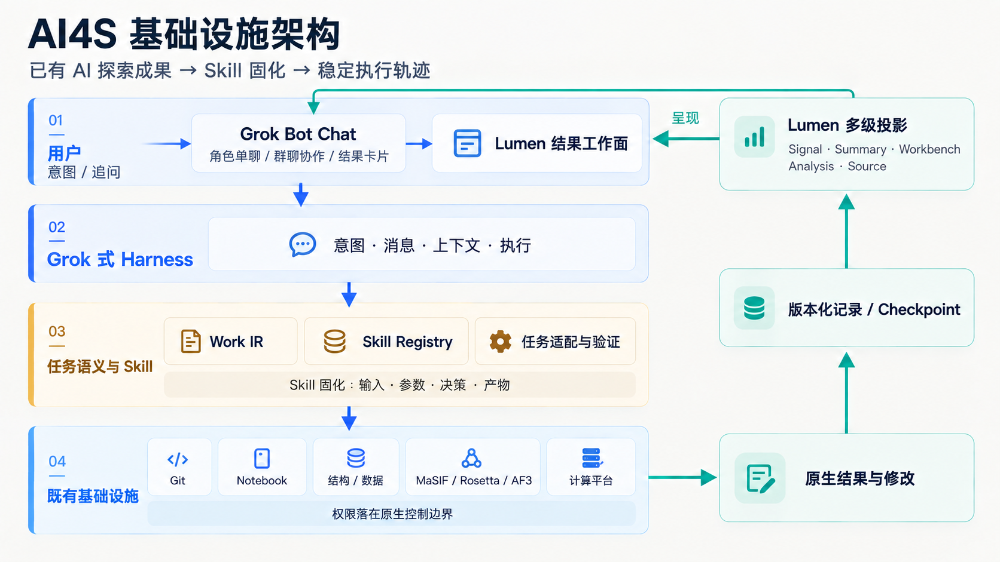
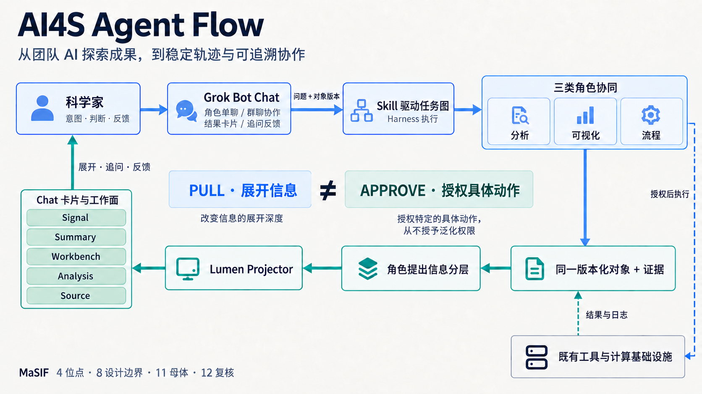
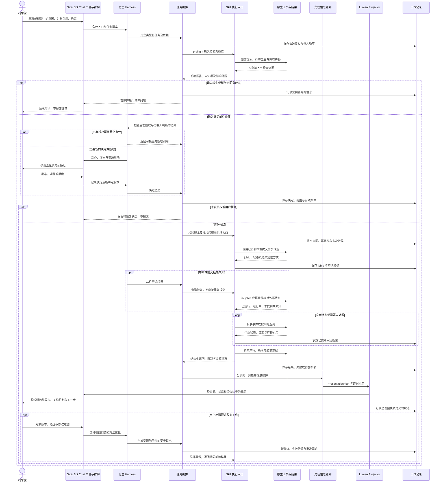
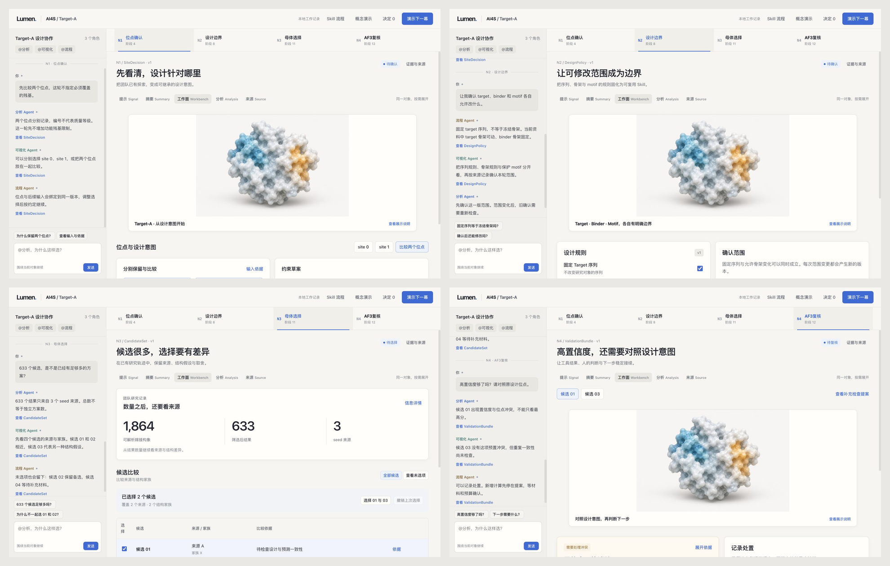

# AI4S 产品化框架与 MaSIF 案例详细技术设计

版本 v0.3 · 2026-09-10  
用途：与 Agent running 团队对齐实现边界，并为投资人的技术方向审阅提供可定位的架构、合同、轨迹与证据入口。

## 0 文档结论与事实基线

我们要产品化的是团队已经用 AI 跑出的科研探索能力。原始 Lumen 提供对象化、多级呈现的基础；新版按任务类型让 Agent 承载分析、可视化与流程工作，通过 Grok 式协作入口和 Harness 组织执行，再以 Skill、工作合同和可恢复记录，使同类任务稳定走过可比较的轨迹。

角色与群聊是重要的 HCI：让科学家可以委派、追问、修正和作决定。它们不意味着模拟一套研究组职级。基础设施继续承载代码、数据、方法、计算与权限，产品不重新设计 Git、Notebook 或一套封闭科研平台。

本设计区分四类状态：

| 类别 | 当前事实 | 审阅时如何核实 |
|---|---|---|
| 团队已有科研探索 | 用户确认 Word 中的流程与结果来自团队用 AI 实际运行的工作 | 团队报告；进一步核对原始结构、脚本、输出和运行记录 |
| 已有产品原型 | landing-handoff 中已有 Lumen 对象、atoms、LOD、群聊/工作面等前端原型 | 本地代码和实际界面；不由产品文案推断已有后端 |
| 本轮产品化工作 | 统一设计、两张视觉架构图、四节点可交互页面、UI设计图及数据骨架 | 当前工作目录的文件、页面行为与限定范围的UI检查记录 |
| 目标框架 | Skill 执行合同、真实 Harness/工具接入、轨迹回归、权限与中断恢复 | 接口契约、集成测试与参考轨迹，而非仅凭架构图 |

“本轮尚未收到某些原始文件”不意味着团队没有成果；“团队已有成果”也不等于新产品的每个自动化边界都已完成集成。设计与审阅均保持这一区分。

第一条产品切片采用 MaSIF 第 4、8、11、12 环节。整体目标是让已有工作由“懂流程的人带着 AI 跑”演进为“用户可协作、Agent 可稳定执行、团队可检查接管的产品”。

## 1 固定的产品与架构原则

1. **基础设施是工作底座。** Git 管代码与配置版本，原始结构/数据存储管源材料，计算平台管实际作业，既有身份和权限管访问边界。
2. **工作对象先于聊天。** 意图、任务、产物、参数、决定与证据有稳定引用；群聊及各级结果是它们的接口和投影。
3. **任务类型决定能力合同。** 可视化、分析、流程执行等角色承担真实职责；不为每个工具建立一个人格。
4. **Skill 固化可复用工作。** 固化的是输入要求、操作入口、判断点、产物、验证和恢复语义，不是强制模型逐字模仿一次成功对话。
5. **角色管理多级信息。** Agent 根据问题组织语义，确定性规则守住来源、版本、必要限制和受众；展示程序不充当新的科研权威。
6. **弱黑箱可追溯。** 不要求公开私有推理，但实际输入、工具变换、产物、决定、结果未知和后续动作必须可查。
7. **自动化有范围。** 已批准范围内自动继续；改变科学目标、设计范围、资源或外部效果时重新评估，不能由群聊共识代替授权。
8. **产品可接管。** 换执行实例、模型、UI 或 Harness 后，工作依然可以从原生记录、Skill 与检查点继续。

主展示页面保持干净，优先呈现结果、选择和协作；来源、当前执行方式与技术细节可按需展开。清爽展示不改变底层事实和记录。

## 2 完整基础设施架构

### 2.1 宣讲概览



[可编辑矢量图](diagrams/01-infra-architecture.svg) · [矢量版 PNG](diagrams/01-infra-architecture.png)。主图为 imagegen 视觉版；下方详细逻辑图与合同是研发对齐依据。这是一张产品化目标架构图，不是对当前部署服务的枚举。

### 2.2 详细逻辑结构

以下框是职责边界，不要求分别部署为微服务。单进程参考实现也应保持这些接口与约束。

~~~mermaid
flowchart TB
    scientist["科学家与授权用户"]
    subgraph experience["Grok Bot Chat 协作与呈现"]
      directChat["与角色单聊"]
      groupChat["群聊与任务线程"]
      chat["Grok Bot Chat 消息与结果卡"]
      views["结果工作面与五级信息"]
      decisions["决定与操作批准"]
    end
    subgraph hostLayer["可替换宿主与工作组织"]
      harness["Grok 式 Harness"]
      compiler["任务编排与依赖图"]
      skillRegistry["版本化 Skill 注册与校验"]
      contextCompiler["Context Compiler"]
      workers["类型化任务 Agent"]
    end
    subgraph contracts["公共工作合同与可追溯状态"]
      workIR["Work IR"]
      journal["执行日志与工具回执"]
      checkpoint["可读工作检查点"]
      projector["Lumen 投影校验"]
      reconcile["原生变更回流与失效传播"]
    end
    subgraph execution["基础设施适配与执行"]
      gateway["现行权限与效果门禁"]
      adapters["原生工具与产物适配"]
    end
    subgraph native["团队拥有的既有基础设施"]
      code["Git 与 Skill 方法配置"]
      data["结构 数据 指标与原始输出"]
      compute["现有科学工具与计算平台"]
      iam["身份 凭据 权限与审批"]
      records["Notebook 与开放工作记录"]
    end
    scientist --> directChat
    scientist --> groupChat
    directChat --> chat
    groupChat --> chat
    scientist --> decisions
    views --> scientist
    chat --> harness
    harness --> compiler
    skillRegistry --> compiler
    compiler <--> workIR
    workIR --> contextCompiler
    contextCompiler --> workers
    workers --> gateway
    decisions --> gateway
    iam --> gateway
    gateway --> adapters
    adapters --> code
    adapters --> data
    adapters --> compute
    adapters --> records
    adapters --> journal
    journal --> checkpoint
    checkpoint --> contextCompiler
    compute --> reconcile
    data --> reconcile
    code --> reconcile
    records --> reconcile
    reconcile --> workIR
    workers --> workIR
    workIR --> projector
    projector --> views
    projector --> chat
    code --> skillRegistry
~~~

这张图的关键闭环是：人的意图进入任务合同，执行通过既有工具发生，结果和外部修改回流为版本化工作状态，再投影给人。Agent 不是事实的唯一写入者；科学家在原生工具里的工作也能进入同一个闭环。

### 2.3 必须复用与需要新增的边界

| 责任 | 优先复用 | 我们新增或固化 |
|---|---|---|
| 对话、模型调用、turn/step、消息续接 | 可接入的宿主 Harness | 将宿主事件适配到工作合同与返回契约 |
| 科学计算 | 团队已跑通的脚本、工具和执行环境 | 结构化入口、输入校验、作业引用与结果验证 |
| 方法版本 | Git、配置文件、已有流程说明 | Skill 清单、版本锁定与兼容检查 |
| 原始数据和结构 | 团队现有文件/数据目录 | ArtifactRef、来源、hash/version、访问引用 |
| 身份与权限 | 团队现有账户、IAM、执行环境隔离 | 将当前授权与具体任务、动作、预算绑定 |
| 工作状态 | 原生运行状态与团队拥有的记录 | Work IR、决策、未决效果、检查点及重建投影 |
| 信息呈现 | 旧 Lumen、既有科学 viewer/绘图工具 | 角色的 PresentationPlan、最低保留规则、反馈路由 |

Grok 是上层协作与 Harness 的复用方向，不据重建源码分析假设已经开放了全部所需接口。DSH 可以是参考实现的可替换承载；若其现成任务、邮箱或日志机制符合合同，就直接适配，不另造通用调度平台。具体后端选择不改变上述边界。

## 3 模块与接口设计

### 3.0 Grok Bot Chat 是完整协作接口

Chat 层与 Harness 执行层分开设计。科学家可以与一个职责角色单聊，也可以在群聊/任务线程中让分析、可视化和流程角色围绕同一对象协作。群聊中的结果卡、工作面中的结构视图与来源抽屉引用同一 artifact/version，避免复制文本造成版本漂移。

用户可在 Chat 点名角色、追问结果卡、引用具体版本或选区；消息经过意图和受众处理进入任务编排。Agent 完成工作后，通过可定位的交付把结果与限制返回原线程，用户可以 PULL 展开或提出修改。需要授权的动作使用独立决定卡，不能把一次普通消息、点赞或阅读当作批准。

最小消息合同包括 messageId、senderActor、roleRef、recipients、conversation/threadRef、taskRef、objectRefs及版本、replyTo/causationId、visibility和deliveryState。单聊与群聊分别执行上下文过滤；跨线程转发检查受众，不把私人记忆、文件或凭据隐式带入群聊。消息送达、任务认领、计算完成与科学复核仍是不同状态。

Grok Bot Chat 提供上层人机协作范式；实际接入哪些消息、卡片、权限及线程接口，需要运行团队与产品框架共同验证，不将产品界面概念误写成某个已公开 SDK 的保证。

### 3.1 宿主适配 Host Adapter

最小能力是接收消息/触发、分派任务、获取结构化产物、观察生命周期、取消或续接、读取必要上下文/日志及执行批准状态。

接口示意：

~~~text
acceptIntent(input, actorContext) -> IntentRef
dispatch(taskContract, skillVersion, contextManifest) -> RunRef
observe(runRef, cursor) -> events + nextCursor
interrupt(runRef) -> cancellationRequestReceipt
resume(taskRef, checkpointRef) -> RunRef
deliver(deliveryContract, artifactRefs) -> DeliveryReceipt
~~~

接口是目标合同，不代表 Grok 的真实 API 名称。接入核对必须记录每项能力是原生支持、通过受控工具补充、只能观察部分，还是不支持。

不能观察的内部步骤不由模型补写成“实际日志”；会影响授权或重复执行安全的缺口应收缩执行范围，并进入接入问题清单。

### 3.2 任务编排与 Skill Registry

编排器根据意图与已确认约束组织依赖，不直接拥有所有领域逻辑。Skill Registry 提供经过版本化管理的执行说明、输入输出类型、工具入口和检查规则。

Skill 变更视同方法/软件变更：有版本、diff、责任人和回归样例。模型可提出修订，但不能未经相应确认就把新的科研假设或资源范围作为默认执行规则。

### 3.3 工具与基础设施 Adapter

每个 adapter 至少声明：

- 原生输入/输出及其标识和版本规则；
- 必需的身份、资源作用域和执行环境；
- 提交、查询、取消与结果读取方法；
- 幂等键支持情况，如何区分失败和结果未知；
- 输出完整性与语义验证分别由谁负责；
- 哪些操作可回滚，哪些只能中止、补偿或人工接管。

对于当前 MaSIF 切片，优先包住团队已有的工具入口，不在产品化阶段顺便重写科学算法。具体命令、镜像、调度器、路径和软件许可需由 running 团队提供并核对。

### 3.4 原生变更回流 Reconciler

Reconciler 将原生文件、作业和人工决定的变化映射回工作对象，更新版本或标记依赖需复核。它不把“最后写入”自动当作科学上正确。

例如更改位点选择会使下游输入版本过期；更改显示尺度仅产生新 view，不必使分析任务失效。冲突无法自动判断时保存两个版本与原因，交给对应角色或人处理。

## 4 Work IR 与事实归属

Work IR 是公共表示，不是要替代所有原生文件。它至少连接以下记录：

| 记录 | 关键内容 | 不能被混淆的边界 |
|---|---|---|
| Intent | 问题、目的、成功条件、非目标与用户修正 | 建议不等于用户决定 |
| TaskContract | 类型、输入版本、约束、责任、依赖、返回要求 | 角色名不等于执行主体 |
| SkillRef | 技能版本、方法/工具配置、兼容范围 | 技能文本不授予权限 |
| ArtifactRef | URI/path、版本/hash、类型、来源与访问范围 | 图或摘要不替代原数据 |
| Decision | 输入/提案版本、选择、理由、决定者 | 点击查看不等于批准 |
| CapabilityRef | 当前权限引用、动作/资源/预算、期限 | 旧批准不永久有效 |
| RunRecord | 请求、作业 ID、配置、状态观察、异常 | 超时不等于未执行 |
| Evidence/Claim | 支持/反驳、条件、限制和复核状态 | 引用存在不等于结论成立 |
| PresentationPlan | 层级、受众、选择内容、限制与下钻 | 摘要不能提升证据等级 |
| Checkpoint | 事件水位、工作版本、待交付、未决效果、下一步 | 压缩不能抹掉义务 |

### 4.1 所有权与物化

代码和方法配置留在团队的代码/配置存储；结构和完整模型输出留在原生数据目录；真实作业状态来自运行平台。新增的任务、决定、检查点可落为团队拥有的开放 JSON/JSONL/YAML 或现有项目元数据，具体位置由 running 团队选择并统一。

同一种事实必须有一个明确权威写入点。运行时可以有缓存、索引和队列，但不能使用户必须保留产品私有数据库才能理解成果或接管未完成工作。

物化边界至少包括：正式委派、方法或资源范围决定、外部操作意图、实际结果、关键验证、交接与退出。不是要求每次 token 生成都进入科研记录。

### 4.2 最小记录实例

下面是合同形状示意，名称和引用不是已经存在的团队生产文件。

~~~yaml
schemaVersion: ai4s.work/v0.1
kind: TaskContract
id: task:graft-selection
taskType: candidate-selection
skill:
  name: GraftSelection
  version: proposed-v0.1
inputs:
  - artifactRef: artifact:graft-candidates
    requiredRevision: bound-at-dispatch
constraints:
  preserveSourceLineage: true
  doNotChangeScientificObjective: true
decisionPolicy:
  requireHumanFor:
    - parent-set-selection
    - source-quota-change
    - compute-budget-expansion
outputs:
  - CandidateSet
  - SelectionRationale
  - EvidenceManifest
presentation:
  levels: [signal, summary, workbench, analysis, source]
  mustRetain: [objectRevision, reviewState, keyLimits, sourceRefs]
recovery:
  checkpointBeforeExternalEffect: true
  queryUnknownEffectBeforeRetry: true
~~~

业务参数应在领域配置中版本化，不要把手册某个实例的阈值直接提升为所有目标都适用的默认值。

## 5 权限 执行与可追溯边界

### 5.1 三种权力分别检查

信息访问决定 Agent 与用户能看到什么；呈现规则决定信息如何展示；操作授权决定允许在原生系统做什么。三者可引用同一身份和策略，但不能互相代替。

角色与群聊可以路由工作，不能通过名称或共识扩大权限。Lumen 可以决定展示层级，不能因为用户展开一张卡就批准重新计算。用户的批准绑定具体提案和版本，修改目标、输入、设计范围或资源范围后重新检查。

### 5.2 外部效果与事件

提交前保存 effect intent 和稳定请求标识，提交后记录原生 job ID 与接收回执，再通过查询读取真实状态与产物。

~~~text
提案 → 输入绑定 → 范围确认 → 提交意图持久化
     → 原生执行/观察 → 产物记录 → 验证 → 交付
                          ↘ unknown：先查证再重试
~~~

取消请求不等于已停止；界面回退不撤销已经发生的计算。任何跨系统“恰好执行一次”保证都需原生幂等支持，否则应保留 unknown 或重复风险并采用验证查询。

### 5.3 记录的真实来源

执行记录来自工具/adapter/平台返回，而非仅来自 Agent 自述。模型给出的解释是解释对象，不能冒充原生执行证明。

密钥和长期凭据由原生秘密管理/执行环境处理，不写入 prompt、图形、导出或普通运行日志。来源内容遵守权限与保留政策，投资人审阅优先使用经团队批准的脱敏材料。

## 6 对齐已有 AI 探索与产品化目标

团队已经验证的价值是 AI 可以推动这条探索流程并产生手册中的结果。产品化新增的工程责任是：将成功路径中隐含的输入约定、人工选择、工具使用和错误处理外显化，形成可复用 Skill 与可比较参考轨迹。

参考轨迹至少收集一次代表性完整运行，并保留失败、分支和人工判断，而不是只保留最终成功候选。没有逐条原始数据时，手册仍可作为流程和阶段数量的依据，但不据此伪造候选级关联。

轨迹接近性的首要对象是工作意义：同样的输入绑定、判断点、工具与方法版本、产物类型、验证要求和可恢复状态。自然语言不必逐字相同，随机输出也不要求逐位一致；输出容差和领域质量标准由研发根据任务明确。

详细 Agent flow、Skill 合同与 MaSIF 节点映射见以下章节。

## 7 详细 Agent Flow



[可编辑矢量图](diagrams/02-agent-framework.svg) · [矢量版 PNG](diagrams/02-agent-framework.png)。主图为 imagegen 视觉版，显式包括 Grok Bot Chat；下方时序图进一步展开执行、判断、恢复与反馈路径。

### 7.1 从已有成果进入可重复的工作流

Word 中的科学流程和数值来自团队使用 AI 实际运行的探索成果。本设计把其中的任务、判断与交接固化为可执行合同，再接入角色群聊和结果工作面。已有计算成果、我们新增的交互脚本、当前 HTML 尚未连接后台，是三个不同事实；以下描述的是目标运行合同，不表示相关能力已全部实现。

分析、可视化、流程角色是可寻址的任务与信息责任入口。宿主 Harness 负责轮次、工具调用和事件续接；任务编排负责依赖、合同状态与交付；Skill 提供领域规程，通过现有执行入口工作，不启动另一套永久 Agent 循环。角色显示身份、实际执行主体、模型实例及权限分别记录。



### 7.2 批准、状态与完成的边界

批准绑定 `taskId/revision`、精确输入版本、动作范围、参数配置摘要、资源约束和批准人，而不是绑定某个角色名字。执行前再次核对输入和合同是否仍匹配。目标、方法、输入、预算或外部效果范围变化时，先判断旧批准是否覆盖；超出范围或已撤销即暂停。人可以调整或拒绝建议，系统不能把“展开依据”解释成同意。

编排层至少区分需要输入、等待决定、可执行、已提交、等待外部结果、验证中、待复核、失败、取消与交付状态。作业终态由原生平台查询支撑，不能由群聊语气推断。“发送成功”“认领任务”“作业结束”“产物已验证”“科学判断成立”“交付可定位”分别记录；验证未通过也要返回可诊断结果，不能只留下空白或统一绿色完成态。

## 8 Skill 包、执行合同与稳定轨迹

### 8.1 Skill 是可版本化工作规程

每个 Skill 包由说明、输入输出约定、前检、执行适配、验证与恢复规则组成。以下字段是拟议结构，不是已经安装的包或现有实现的接口保证：

```yaml
skillId: <name>
skillVersion: <version>
inputSchemaRef: <versioned-input-types-and-requirements>
outputSchemaRef: <versioned-output-types-and-requirements>
constraints: <scientific-intent-and-operational-boundaries>
parameterSchema: <typed-schema-ref-and-version>
toolVersions: <tool-and-environment-version-refs>
preflight: <input-mapping-capability-and-prerequisite-checks>
humanDecisionPolicy: <decision-points-and-approved-scope>
execution:
  entry: <existing-script-workflow-or-adapter-ref>
  asyncContract: <submit-query-cancel-and-idempotency-capabilities>
verification: <checks-required-evidence-and-review-policy>
return: <status-output-refs-evidence-warnings-next-actions>
recovery: <checkpoint-query-reconcile-and-resume-policy>
lod: <required-claims-caveats-and-source-drilldowns>
```

SkillDefinition 中的 `inputSchemaRef` 和 `outputSchemaRef` 描述可复用的类型与要求；具体运行在 TaskContract/RunManifest 中绑定 `inputRefs` 和 `outputRefs`，指向精确版本的团队原生对象。不把大文件复制进聊天作为事实源，也不把一次运行的数据绑定写死进通用 Skill。`parameterSchema` 规定类型、必填项和允许变更，不在此新增分子设计阈值。`toolVersions` 固定可核验的工具、脚本和环境信息；无法读取的部分标为缺口。`preflight` 检查文件、链与残基映射、依赖、输出位置和执行能力，但不能替人猜测科学目标。

`humanDecisionPolicy` 定义必须询问的节点、可沿用的授权与失效条件。`execution.entry` 调用已有脚本、工作流或适配器；异步等待由宿主事件和原生调度承接。`verification` 明确哪些检查可机械完成、哪些需要科学复核。`return` 同时容纳成功产物、部分结果、失败证据与未知项；`recovery` 和 `lod` 使同一任务能够被继续执行、解释和接管。

### 8.2 四个拟设计包

- `SiteSelection` 对应阶段 4：读取目标与表面结果，整理位点覆盖及意图歧义；返回位点选择对象和批准记录，未确认目标区域时不进入搜索。
- `RosettaDesign` 对应阶段 8：把链角色、可改与不可改边界及已有预算绑定到配置；返回原生设计产物、配置版本和结构比较，边界变化重新评估授权。
- `GraftSelection` 对应阶段 11：读取嫁接结果及来源谱系，按既定检查形成可比较母体集合；保存来源配额、取舍与淘汰理由，不以候选总数代替独立来源。
- `AF3Review` 对应阶段 12：汇总已有预测及复核证据，暴露位点、构象与指标冲突；返回复核、降级或回退建议，追加计算按批准范围执行，不把预测完成写成实验成功。

以上是待实现和接入验证的 Skill 包名称，不是为每个工具创建一个人格，也不意味着它们已安装。各包可由相同执行实例承接，角色根据任务和产物承担信息责任。

### 8.3 稳定不等于逐字复现

稳定轨迹要求控制节点、输入版本、关键工具及产物、验证依据、异常分支能够比较。运行清单应保留这些锚点与差异原因，而非只比较最终聊天文字。随机采样、排序或表达可以不同；在适用条件下，后续运行应能重走接近的工作路径并解释偏离。

旧轨迹是比较基线，不是强制答案。新证据、输入变化或工具版本变化可能要求回退或改变方案；系统必须记录理由，不能为追求旧结果而忽略反证。产品化验收同时检查正常完成、输入歧义、撤销、部分失败、异步中断和原生修改后的恢复，具体科学验收条件由团队已有规程确认。

## 9 角色管理多级信息与 Lumen 呈现

### 9.1 PresentationPlan 的责任与校验

分析角色维护观察、比较、方法与限制；可视化角色维护图形映射、结构视角和显示变换；流程角色维护依赖、决定、资源和接续。它们分别对自己负责的对象提出 `PresentationPlan`，不把全部语义交给一个全局摘要员。

计划包含 `objectRef/objectVersion/roleRef`、受众与用户问题、所选层级、`selectedClaims/evidenceRefs/caveats`、省略内容及下钻引用、建议表面和请求关注的原因。群聊、工作面与抽屉都引用同一对象版本；新结果到达时更新投影，不各自维护一份可能漂移的结论。

Lumen 校验版本对应、受众可见范围、必要状态、来源与限制以及可用下钻。展示空间不足时换表面或请求展开，不能截掉决定性限制。程序检查保证最低信息合同，不证明所有语义正确；证据是否支持结论仍需对照和复核。窗口排版和已有层级切换优先使用确定性规则，不要求每次调用模型。

### 9.2 五级信息与干净的主画面

- `Signal` 回答“是否需要我注意”：显示关键变化、冲突或待决事项，不用工具日志占据主屏。
- `Summary` 回答“已知与未知是什么”：给出主要结果、适用范围和下一步，不把待复核压缩成已确认。
- `Workbench` 支持比较、选择和调整：保持当前对象、版本、选区与筛选条件可定位。
- `Analysis` 展开方法、诊断、反证、敏感性与复核理由；外显说明不冒充模型私有推理。
- `Source` 打开原始文件、代码、运行与决策引用；未提供的记录明确写未提供，不推断其不存在。

主画面呈现工作与决定，来源类别和执行细节按需展开，不反复贴“合成／回放”标签。会影响当前判断的冲突、过期、未复核等限制仍直接可见。团队 Word 实跑记录、新增 `DEMO-M01…04` 交互脚本、AI 概念图与本次前端执行方式分别保留身份，来源入口不能把它们混成一次实时计算。

`PULL != APPROVE`：展开、放大、换视角只改变信息呈现；批准绑定具体动作和版本。临时隐藏候选是视图调整，从分析中排除候选则是方法变更。后者产生新任务修订，计算依赖影响范围并检查授权，只重做受影响子图，同时保留旧版本及其理由。

## 10 检查点、查询恢复与交付连续性

### 10.1 保存工作状态，不依赖角色记忆

检查点保留目标与用户修正、任务合同修订、精确输入、Skill 与工具版本、对象谱系、关键证据、决定和权限引用。另行保存 `pendingEffects`、异步 `jobId`、查询游标、`pendingDeliveries`、接收者、交付对象版本、当前阻塞和下一步。长日志与探索过程保留引用，不要求复制模型私有推理或厂商内部状态。

`pendingEffects` 表示尚不能确认的外部效果，例如提交是否被接受；`pendingDeliveries` 表示已有结果但尚未完成约定交付。两者不能合并成“任务还没完成”，否则恢复时容易重复计算或丢失交付。交付回执只证明相应发送或呈现动作，不自动证明接收者已阅读、认可或完成科学复核。

### 10.2 先查外部事实，再决定续跑

恢复首先读取检查点并重新验证当前权限，再按原生作业标识或幂等键查询。若作业仍运行，继续等待；若已完成，检索并验证产物；若确定未提交且授权仍有效，才按合同重试；若外部效果仍未知，保留未知并请求补验或人工处理。查询不到一次作业不必然等于它从未运行。

人在原生工具中改文件、取消任务或补充证据后，先对账再更新依赖，Agent 缓存不能覆盖原生变更。撤销后停止新的授权动作，并查询已提交效果；不能把前端已显示取消当成底层作业已经停止。

### 10.3 压缩与可替换接续

Context 压缩不授予权限、不延长批准有效性，也不能把“待复核”改成“已确认”。压缩前后要能定位同一任务、关键版本、权限引用、未决效果和待交付结果；续接实例按需加载这些对象，而非重新灌入整个群聊。更换模型或 Harness 后仍先核验记录及原生状态，再恢复工作。

宿主未暴露的执行事件标为追溯缺口，说明影响哪些检查及后续自动化范围。应优先保留可验证输入、输出和控制边界，而不是让模型补写看似完整的历史。以上合同需要通过实际接入和异常测试逐项验证，才能从交互原型进入稳定产品。


## 11 MaSIF 团队成果的产品化案例

本案例从团队已经完成的 AI 探索出发：用户确认，Word 中的数值与科学结果来自 Agent 探索团队实际运行。产品化目标是把有效的工作方法沉淀为 Skills，让新框架稳定承接相近轨迹，并让科学家控制关键选择。以下合同、事件和交互是拟实现设计；来源说明统一见第13章。

### 11.1 已有轨迹及数量口径

流程连接为：target与链确认→表面和位点→MaSIF搜索与诊断→片段聚类→Rosetta优化及联合筛选→MotifGraft嫁接→母体选择→AF3复核→界面分析。四个主展示节点是N1／阶段4、N2／阶段8、N3／阶段11、N4／阶段12，中间环节保留在任务轨迹中。

团队报告：208个MaSIF匹配，site 0／1分别为194／14；聚类保留60个代表，即6类各10个；阶段9筛后13个seed／motif进入嫁接；嫁接产生1864个可解析构象，筛后633个，仅来自3个seed ID；150个复合物进入AF3，每个输入使用一个model seed。13不是阶段8的全部输出，13→1864是生成扩增，各阶段对象不同，不能画成单调漏斗。633条的来源占比、633→150的名单映射未提供，150也不是成功验证数量。

### 11.2 N1／阶段4：位点确认

**原文输入与事实。** 输入为可唯一识别的target结构与链、表面mesh、描述符和位点预测，以及用户掌握的功能残基信息。报告保留两个site，未启用target residue，覆盖半径未固定。两个编号不是质量等级。

**Skill合同。** 校验结构版本、链、残基编号及表面产物；输出SiteDecision，记录选中位点、残基限制、允许偏移、未决信息与批准人。必要输入不完整时只形成草案。已知表位、链角色或预算发生变化时，不能沿用旧决定。

**用户与角色。** 用户：“先比较两个位点，这轮不指定必须覆盖的残基。”分析Agent：“分别记录两个site，后续命中不要混成一个分布。”可视化Agent：“点选或叠合查看覆盖范围。”流程Agent：“保存本轮约束；必要信息补齐后才能衔接搜索。”

**产物、LOD与操作。** 提示层显示待确认；摘要层显示位点选择；工作面提供表面切换；分析层展开几何、化学、功能残基覆盖与重叠；来源层定位结构、链和参数。用户可切换、比较、保存草案。只有保存决定才改变下游约束，旋转结构和展开证据不产生授权。

**事件与返回条件。** SiteDecisionSaved记录版本和理由；InputAmbiguous将任务留在检查点；表位变化触发DecisionInvalidated并返回本节点。用户确认科学意图，Agent自动完成格式校验与汇总，不能替人补出生物学目的。

### 11.3 N2／阶段8：Rosetta设计边界

**原文输入与事实。** 输入是聚类代表的target–seed复合物、motif与来源关系。报告固定target序列、允许binder设计并排除Cys；骨架设置却是target可动、binder固定，不能画成target完全冻结。报告参数包括10 Å邻域、8 Å界面定义、界面权重3、FastRelax 10次和FastDesign 1次；这些是已有设置，不是本方案新推荐的通用阈值。

**Skill合同。** DesignPolicy明确链角色、固定motif、可设计残基、骨架柔性、允许氨基酸集合及预算。RunBundle绑定输入哈希、参数版本、工具版本、任务ID和产物引用。验收检查任务完整性、结构漂移及每簇可比较结果，不能仅凭进程退出成功就宣布科学上通过。

**用户与角色。** 用户：“让我确认哪些部分能改，扩大范围或预算再问我。”分析Agent：“序列限制和骨架限制需要分开核对。”可视化Agent：“分别显示保护motif、可设计区域和骨架规则。”流程Agent：“批准绑定这一版规则；修改范围后重新确认。”

**产物、LOD与操作。** 从“设计范围待确认”进入规则摘要，再到区域图层与前后叠合；分析层展示界面RMSD、总能量／界面能变化、独立运行收敛及各簇完成率；来源层查看配置和日志。用户可调整边界、比较版本、确认范围。当前缺失的结构映射与测量值在来源处列明。

**事件与返回条件。** DesignPolicyApproved只批准具体输入和参数版本；PolicyChanged使旧批准失效；RunCompleted后仍需ArtifactValidated。链角色错误、motif受损、明显漂移或预算超限时停止衔接并返回边界检查；已批准范围内的校验、汇总和运行管理由Agent完成。随后保留阶段9联合筛选和阶段10嫁接扩增的桥接产物。

### 11.4 N3／阶段11：嫁接筛选与母体选择

**原文输入与事实。** 输入为嫁接结构、界面指标及seed—scaffold谱系。报告先用形状互补性、ddG、SASA、总能量、BUNS和氢键过滤，后续使用面积归一指标。1864→633是筛选；仅3个来源说明需要检查冗余，不能推断三者比例或独立折叠数量。

**Skill合同。** CandidateSet保留入选、未选、待定对象和理由；先执行碰撞、motif偏移、界面缺失等硬约束，再组织多指标候选，按seed、scaffold折叠和界面模式去冗余。配额与母体规模由用户批准，指标定义及归一方法版本化；不发明未经校准的总分。

**用户与角色。** 用户：“633个是不是已经够多？给我保留不同结构假设。”分析Agent：“总数不等于独立方案数，还要核对来源和界面模式。”可视化Agent：“打开来源与结构家族对比。”流程Agent：“保存选择和未选理由，保留可撤销路径。”

**产物、LOD与操作。** 主卡显示团队报告的633／3，候选区展示独立交互样例：DEMO-M01和M02同来源同家族，M03代表不同假设，M04待补证据。用户选M01、M03进入复核；M02保留为未选备选，M04保持待定。分析层承载逐指标淘汰、来源分布和Pareto证据，来源层定位全量表与筛选记录；没有原表时不生成虚假分布。

**事件与返回条件。** CandidateSelectionProposed与SelectionApproved分开；对象改变使批准失效。缺少谱系时请求补材料，来源过度集中时请求重分配配额，几何普遍失败时返回嫁接或更早节点。未选不等于失败，撤销也不能删除历史理由。

### 11.5 N4／阶段12：AF3复合物复核

**原文输入与事实。** 输入为候选复合物、原设计结构及来源。报告复核150个输入，各用一个model seed；不能据此展示随机重复一致性。source seed表示结构来源，model seed表示预测随机种子，界面与数据模型均须分开。

**Skill合同。** ValidationBundle并列记录目标位点一致性、pair ipTM、完整界面PAE、binder折叠置信度与重复证据。最低PAE不能代表整个界面，高置信度不能消除位点错误。输出是复核状态、证据缺口与下一步提案，不是实验成功。

**用户与角色。** 用户：“高置信度够了吗？请对照原设计位点。”分析Agent：“M01样例中置信度较高却偏离设计区域，不能直接入选。”可视化Agent：“展开设计／预测区域叠合，并与M03对照。”流程Agent：“M01退回复核，M03待进一步检查；新增计算先提交预算方案。”

**产物、LOD与操作。** 提示层暴露冲突，摘要解释为何不能只看最高分；工作面切换候选与结构对照；分析层核对位点、折叠、碰撞和重复证据；来源层展示模型输入、输出引用与处置记录。用户可记录退回、保留、待补，查看复核提案。M01位点冲突和M03状态用于交互讲解，不代替团队原候选判断。

**事件与返回条件。** ValidationConflict触发人工处置；ReviewProposed不等于ReviewSubmitted；BudgetApproved须绑定范围后才允许提交。位点错误或多次预测界面不一致时降级或退回母体选择，材料缺失时待补。Agent不能挑最高分一次结果覆盖矛盾证据。

## 12 Skill轨迹合同与可恢复协作

三个任务型Agent贯穿全流程：分析负责指标、来源和异常；可视化负责对象、结构与层级展示；流程负责依赖、版本、批准与执行。它们共享对象ID和版本，不靠复制聊天文本传递状态。群聊负责解释与协作，持久化决定、证据和执行状态由框架合同承接。

每次推进至少留下：输入引用与哈希、Skill及工具版本、参数、前置决定、候选父子关系、产物、状态和失败原因。用户的确认要绑定对象版本、可修改范围及预算；打开图层、发送追问和切换检查点不是新的执行许可。事件名在此为语义建议，需与框架事件表统一，不表示当前接口已实现。

“稳定跑出非常接近的轨迹”应按合同回归：输入完整时进入正确节点，缺件时停在正确位置，变更时重新授权，输出可找到，失败可恢复。固定输入和环境下比较关键结构、指标、数量及来源变化；允许的科学偏差由团队基于原始运行与重复结果校准，不在演示里预设新阈值。回复措辞、随机候选顺序或随机数值不要求逐字逐项一致。

恢复应从已验证检查点继续：任务超时保留日志与已完成产物，重试避免重复提交；参数变更使相关下游结果标为过期而非删除；恢复时先核对输入、版本和授权。一次成功的HTML点击只能验证交互状态，不能证明上述执行合同已运行。

## 13 研发对齐与技术审阅证据

### 13.1 证据矩阵：现有／待团队提供／待框架实现

- **科学结果。** 现有：团队实跑Word、摘录与报告汇总。待团队提供：完整候选表、指标定义、原始结构、来源分布和633→150映射。待框架实现：材料导入、校验、去重、哈希与可追溯展示。原件尚未进入演示仓库不等于团队没有成果。
- **工作轨迹。** 现有：指南中的阶段、参数与人工判断规则。待团队提供：代表运行的命令、配置、工具／数据库版本、随机种子、任务与日志。待框架实现：Skill合同、工具适配、依赖调度、产物验证及检查点恢复。
- **用户协作。** 现有：四节点脚本和DEMO-M01–04交互样例。待团队提供：实际审批角色、常见追问、失败处置和可接受预算。待框架实现：版本化决定、授权校验、撤销、审计事件和角色间共享状态。
- **验证与收益。** 现有：报告中的AF3计算复核及单model seed口径。待团队提供：需要审阅的原始预测、重复运行和实验材料，以及耗时／成本基线。待框架实现：证据关联、轨迹回归、预算计量和收益测量；不从演示推导命中率或实验结论。

### 13.2 必须通过的回归与异常测试

先选一条团队认可的代表轨迹作为基准，再覆盖：错误链／缺失残基阻止启动；设计范围变化使旧批准失效；N3选择可撤销且未选记录不丢；M01类位点冲突不能被高分绕过；单model seed不得呈现重复一致性；新预算未批准不得提交；超时、重复回调和重试不产生重复任务；材料缺失不被渲染成零值或通过；过期结构与新参数不能混用。

验收逐项关联输入fixture、预期状态、实际事件、产物路径与测试结果。由团队先确认科学判断口径，框架团队负责可执行约束与异常恢复，前端验证图层、卡片和来源是否对应同一个版本。

### 13.3 分阶段交付与审阅方式

第一阶段对齐报告、原件清单与候选谱系，验收口径和公开范围；第二阶段完成交互与事件合同，用样例测试选择、失效、退回与追溯；第三阶段接通一个真实任务与一个失败恢复路径，提交日志、产物及接口测试；第四阶段在团队指定基准上运行端到端回归，再评估稳定性、成本与产品收益。每阶段保留明确的未实现项，不以界面完整度代替执行证据。

技术审阅应要求打开原件、配置、日志、接口与测试，而不是只看漂亮图。报告事实可证明团队已有探索成果；产品化脚本可说明协作设计；只有实际接入和测试才能证明新框架稳定执行。当前HTML未接实跑后端，结构图与候选事件为交互编排；DEMO样例独立于633条真实结果。来源与执行方式在审阅入口分别标明，不在主展示反复插入警示。

本节依据：[团队指南摘录](sources/guide-extracted.txt)、[四节点案例](03_MASIF_DEMO_CASE.md)、[演示介绍](00_DEMO_INTRO.md)。报告对应Word的既有校验值记录于案例文末，科学数值未由本演示重新计算。

## 14 最小实现计划与当前交付

### 14.1 从一条团队参考轨迹开始

第一阶段不是重建通用平台，而是选一条已完成且材料齐全的参考轨迹，将四个决策节点包装为 Skill 合同，复用现有脚本与环境；先打通一个真实执行入口和一次异常恢复，再扩展完整链条。

建议逻辑模块如下，目录只是实现建议，不代表已经创建的后端代码：

~~~text
work-contracts       公共类型与版本校验
skills               四节点规程及回归样例
host-adapter         宿主消息 委派 生命周期与交付
native-adapters      现有工具 提交 查询 产物读取
work-records         决定 谱系 回执 检查点
projectors           角色信息计划及 Lumen 投影
evals                轨迹合同 权限 中断与保真测试
~~~

已有 Harness 能力保持在宿主内；已有科学脚本保持原生入口。不能为了层次看起来完整，就让这些逻辑模块分别变成新的服务、数据库和用户工作空间。

### 14.2 各团队对齐的输入与输出

| 对齐对象 | 需要提供或确认 | 形成的交付 |
|---|---|---|
| Agent running / 科研团队 | 代表轨迹、原件、配置、工具版本、实际人工判断、常见失败与科学容差 | 经认可的参考运行包与领域验收口径 |
| 框架实现 | 宿主接入面、Skill schema、工具合同、权限与恢复语义 | 可执行任务切片、日志、回执与异常测试 |
| 产品与前端 | 对象、角色、五级信息、标注和决定操作 | 可用交互、同版本联动与来源回查 |
| 技术审阅 | 哪些事实已证实、哪些是接口提案、哪些尚待测试 | 能打开原件及对应测试的证据索引 |

判断是否可以进入下一里程碑，应看产物和测试证据，而非仅看规划完成度。具体排期、算力和预算由团队确认，本文件不虚构开发工期或运行收益。

### 14.3 本次可直接使用的材料

- [演示介绍与三分钟路径](00_DEMO_INTRO.md)：快速对齐展示顺序。
- [MaSIF 详细交互脚本与四屏草图](03_MASIF_DEMO_CASE.md)：给设计与前端拆任务。
- [演示页面文件](app/index.html)：对真实探索流程进行产品化交互编排；不是提交真实科研作业的后端。
- [候选交互与报告数字骨架](demo-fixtures.json)：团队报告事实与独立候选 UI 样例分别保存。
- [基础设施图](diagrams/01-infra-architecture.svg) 与 [Agent 框架图](diagrams/02-agent-framework.svg)：可编辑矢量图，另有同名 PNG。

页面可以验证角色、选择、信息层级、版本失效等前端行为，不能单靠它证明真实工具接入或科学复现完成。浏览器验收与后端集成验收应分别记录。

### 14.4 四页 UI 设计与实现



独立页面图：[位点确认](app/pages/01-site.png)、[设计边界](app/pages/02-design.png)、[母体选择](app/pages/03-selection.png)、[AF3复核](app/pages/04-review.png)。页面已实现为可交互工作台，不只是静态海报；主画面保持精简，执行范围和来源在详情中可查。

已在应用内浏览器检查四节点导航、候选选择/撤销、规则改变后的确认失效、复核处置与信息层级切换；未发现console error。详细范围与未覆盖项见[UI检查记录](app/design-qa.md)，它不替代后端或科学复现测试。

## 15 审阅清单与验收边界

### 15.1 必须能实际打开的证据

每条关键结果应能定位到报告或原生产物；每条执行保证应能定位到实际接口与测试。材料尚未提供时列为待补，不推断科研工作未发生；集成尚未验证时列为待验证，不以已有研究结果替代。

建议审阅路径：结果卡 → 原生产物 → 输入/参数/工具版本 → 运行与决定 → 复核依据 → 恢复或再执行测试。哈希用于检查内容完整性，不单独证明身份、科学正确性或实验有效性。

### 15.2 最小验收矩阵

| 维度 | 需要看到的行为 | 证据形态 |
|---|---|---|
| 参考轨迹 | 正确绑定输入、方法版本和判断点 | RunManifest、事件序列及参考对比 |
| 原生回落 | 文件和结果不依赖聊天读取 | 可打开的产物与版本引用 |
| 人机控制 | 展开不扩权、范围改变重新检查 | 决策/拒绝/撤销测试 |
| 中断恢复 | unknown 先查证，避免重复效果 | 模拟故障与原生查询记录 |
| 交付连续 | 完成产物不会因发送失败丢失 | pending delivery 与发送回执 |
| 科学保真 | 不以高分掩盖位点冲突，不编造重复一致性 | 团队审阅样例与规则测试 |
| 多级信息 | 省略不抬高证据等级，来源可定位 | 不同 LOD 的保真测试 |
| 可替换性 | 换执行实例或后端能接续关键工作 | 可读 checkpoint 与恢复演练 |
| 实际收益 | 用相同口径比较机械工作、恢复、成本与错误 | 经过确认的基线和使用记录 |

本矩阵是待实现的验收规格，不是“全部通过”的声明。正常路径和失败路径应同时提交证据，不能只展示一次成功运行。

## 16 来源与版本说明

业务基础是用户提供的《MaSIF binder 设计全流程与人工选择指南 v2》。用户在本次对话中明确确认：其中数值与科研流程属于团队已用 AI 实跑的探索结果。

- [团队指南文本存档](sources/guide-extracted.txt)。重点章节为四、八、十一、十二；二、九、十、十四用于保持数量、桥接与交互语义。
- 原 Word SHA-256：684e5691e8331a3a774d9aa7e8cff3b765d5c672a939a527b4fbe963f7fee9de。原件未修改。
- [产品与架构 v2](../../AI4S_AGENT_FRAMEWORK_V2.md) 与 [基础设施原生架构](../../INFRASTRUCTURE_NATIVE_AGENT_ARCHITECTURE.md) 为哲学与通用合同背景；本文件中的团队实跑事实澄清与 Skill 产品化方向优先。
- Grok 0.18 材料提供 Harness 设计线索，来自重建源码静态分析，不作为其全部接口已可接入的保证。
- DEMO-M01–M04、相应个体状态、角色回复与概念插图用于交互设计；它们不替代团队真实候选及原始结构文件。产品主画面不反复贴说明，审阅入口保留准确来源。

本文件将“已有探索成果”“目标架构”“本轮交互实现”和“尚待验证的执行保证”分开记录，便于科研、工程、产品与技术审阅使用同一套事实和工作合同。
