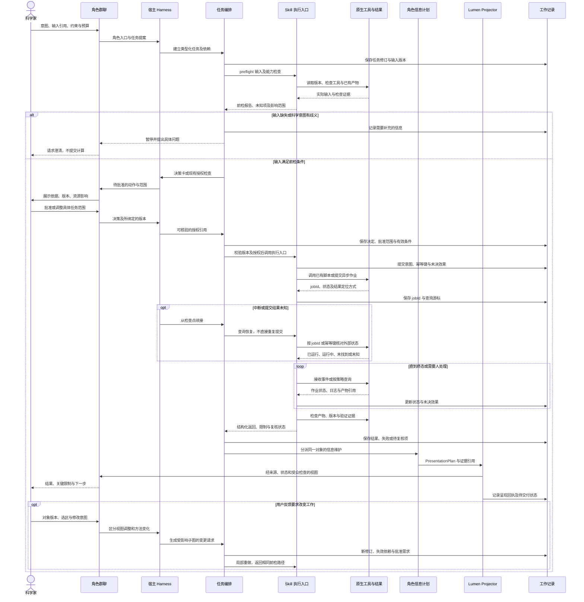

## 7 详细 Agent Flow

### 7.1 从已有成果进入可重复的工作流

Word 中的科学流程和数值来自团队使用 AI 实际运行的探索成果。本设计把其中的任务、判断与交接固化为可执行合同，再接入角色群聊和结果工作面。已有计算成果、我们新增的交互脚本、当前 HTML 尚未连接后台，是三个不同事实；以下描述的是目标运行合同，不表示相关能力已全部实现。

分析、可视化、流程角色是可寻址的任务与信息责任入口。宿主 Harness 负责轮次、工具调用和事件续接；任务编排负责依赖、合同状态与交付；Skill 提供领域规程，通过现有执行入口工作，不启动另一套永久 Agent 循环。角色显示身份、实际执行主体、模型实例及权限分别记录。



### 7.2 批准、状态与完成的边界

批准绑定 `taskId/revision`、精确输入版本、动作范围、参数配置摘要、资源约束和批准人，而不是绑定某个角色名字。执行前再次核对输入和合同是否仍匹配。目标、方法、输入、预算或外部效果范围变化时，先判断旧批准是否覆盖；超出范围或已撤销即暂停。人可以调整或拒绝建议，系统不能把“展开依据”解释成同意。

编排层至少区分需要输入、等待决定、可执行、已提交、等待外部结果、验证中、待复核、失败、取消与交付状态。作业终态由原生平台查询支撑，不能由群聊语气推断。“发送成功”“认领任务”“作业结束”“产物已验证”“科学判断成立”“交付可定位”分别记录；验证未通过也要返回可诊断结果，不能只留下空白或统一绿色完成态。

## 8 Skill 包、执行合同与稳定轨迹

### 8.1 Skill 是可版本化工作规程

每个 Skill 包由说明、输入输出约定、前检、执行适配、验证与恢复规则组成。以下字段是拟议结构，不是已经安装的包或现有实现的接口保证：

```yaml
skillId: <name>
skillVersion: <version>
inputRefs: [{ref: <artifact>, version: <exact-version>}]
outputRefs: [{type: <artifact-type>, destinationRef: <native-store>}]
constraints: <scientific-intent-and-operational-boundaries>
parameterSchema: <typed-schema-ref-and-version>
toolVersions: <tool-and-environment-version-refs>
preflight: <input-mapping-capability-and-prerequisite-checks>
humanDecisionPolicy: <decision-points-and-approved-scope>
execution:
  entry: <existing-script-workflow-or-adapter-ref>
  asyncContract: <submit-query-cancel-and-idempotency-capabilities>
verification: <checks-required-evidence-and-review-policy>
return: <status-output-refs-evidence-warnings-next-actions>
recovery: <checkpoint-query-reconcile-and-resume-policy>
lod: <required-claims-caveats-and-source-drilldowns>
```

`inputRefs` 和 `outputRefs` 指向团队拥有的原生对象，不把大文件复制进聊天作为事实源。`parameterSchema` 规定类型、必填项和允许变更，不在此新增分子设计阈值。`toolVersions` 固定可核验的工具、脚本和环境信息；无法读取的部分标为缺口。`preflight` 检查文件、链与残基映射、依赖、输出位置和执行能力，但不能替人猜测科学目标。

`humanDecisionPolicy` 定义必须询问的节点、可沿用的授权与失效条件。`execution.entry` 调用已有脚本、工作流或适配器；异步等待由宿主事件和原生调度承接。`verification` 明确哪些检查可机械完成、哪些需要科学复核。`return` 同时容纳成功产物、部分结果、失败证据与未知项；`recovery` 和 `lod` 使同一任务能够被继续执行、解释和接管。

### 8.2 四个拟设计包

- `SiteSelection` 对应阶段 4：读取目标与表面结果，整理位点覆盖及意图歧义；返回位点选择对象和批准记录，未确认目标区域时不进入搜索。
- `RosettaDesign` 对应阶段 8：把链角色、可改与不可改边界及已有预算绑定到配置；返回原生设计产物、配置版本和结构比较，边界变化重新评估授权。
- `GraftSelection` 对应阶段 11：读取嫁接结果及来源谱系，按既定检查形成可比较母体集合；保存来源配额、取舍与淘汰理由，不以候选总数代替独立来源。
- `AF3Review` 对应阶段 12：汇总已有预测及复核证据，暴露位点、构象与指标冲突；返回复核、降级或回退建议，追加计算按批准范围执行，不把预测完成写成实验成功。

以上是待实现和接入验证的 Skill 包名称，不是为每个工具创建一个人格，也不意味着它们已安装。各包可由相同执行实例承接，角色根据任务和产物承担信息责任。

### 8.3 稳定不等于逐字复现

稳定轨迹要求控制节点、输入版本、关键工具及产物、验证依据、异常分支能够比较。运行清单应保留这些锚点与差异原因，而非只比较最终聊天文字。随机采样、排序或表达可以不同；在适用条件下，后续运行应能重走接近的工作路径并解释偏离。

旧轨迹是比较基线，不是强制答案。新证据、输入变化或工具版本变化可能要求回退或改变方案；系统必须记录理由，不能为追求旧结果而忽略反证。产品化验收同时检查正常完成、输入歧义、撤销、部分失败、异步中断和原生修改后的恢复，具体科学验收条件由团队已有规程确认。

## 9 角色管理多级信息与 Lumen 呈现

### 9.1 PresentationPlan 的责任与校验

分析角色维护观察、比较、方法与限制；可视化角色维护图形映射、结构视角和显示变换；流程角色维护依赖、决定、资源和接续。它们分别对自己负责的对象提出 `PresentationPlan`，不把全部语义交给一个全局摘要员。

计划包含 `objectRef/objectVersion/roleRef`、受众与用户问题、所选层级、`selectedClaims/evidenceRefs/caveats`、省略内容及下钻引用、建议表面和请求关注的原因。群聊、工作面与抽屉都引用同一对象版本；新结果到达时更新投影，不各自维护一份可能漂移的结论。

Lumen 校验版本对应、受众可见范围、必要状态、来源与限制以及可用下钻。展示空间不足时换表面或请求展开，不能截掉决定性限制。程序检查保证最低信息合同，不证明所有语义正确；证据是否支持结论仍需对照和复核。窗口排版和已有层级切换优先使用确定性规则，不要求每次调用模型。

### 9.2 五级信息与干净的主画面

- `Signal` 回答“是否需要我注意”：显示关键变化、冲突或待决事项，不用工具日志占据主屏。
- `Summary` 回答“已知与未知是什么”：给出主要结果、适用范围和下一步，不把待复核压缩成已确认。
- `Workbench` 支持比较、选择和调整：保持当前对象、版本、选区与筛选条件可定位。
- `Analysis` 展开方法、诊断、反证、敏感性与复核理由；外显说明不冒充模型私有推理。
- `Source` 打开原始文件、代码、运行与决策引用；未提供的记录明确写未提供，不推断其不存在。

主画面呈现工作与决定，来源类别和执行细节按需展开，不反复贴“合成／回放”标签。会影响当前判断的冲突、过期、未复核等限制仍直接可见。团队 Word 实跑记录、新增 `DEMO-M01…04` 交互脚本、AI 概念图与本次前端执行方式分别保留身份，来源入口不能把它们混成一次实时计算。

`PULL != APPROVE`：展开、放大、换视角只改变信息呈现；批准绑定具体动作和版本。临时隐藏候选是视图调整，从分析中排除候选则是方法变更。后者产生新任务修订，计算依赖影响范围并检查授权，只重做受影响子图，同时保留旧版本及其理由。

## 10 检查点、查询恢复与交付连续性

### 10.1 保存工作状态，不依赖角色记忆

检查点保留目标与用户修正、任务合同修订、精确输入、Skill 与工具版本、对象谱系、关键证据、决定和权限引用。另行保存 `pendingEffects`、异步 `jobId`、查询游标、`pendingDeliveries`、接收者、交付对象版本、当前阻塞和下一步。长日志与探索过程保留引用，不要求复制模型私有推理或厂商内部状态。

`pendingEffects` 表示尚不能确认的外部效果，例如提交是否被接受；`pendingDeliveries` 表示已有结果但尚未完成约定交付。两者不能合并成“任务还没完成”，否则恢复时容易重复计算或丢失交付。交付回执只证明相应发送或呈现动作，不自动证明接收者已阅读、认可或完成科学复核。

### 10.2 先查外部事实，再决定续跑

恢复首先读取检查点并重新验证当前权限，再按原生作业标识或幂等键查询。若作业仍运行，继续等待；若已完成，检索并验证产物；若确定未提交且授权仍有效，才按合同重试；若外部效果仍未知，保留未知并请求补验或人工处理。查询不到一次作业不必然等于它从未运行。

人在原生工具中改文件、取消任务或补充证据后，先对账再更新依赖，Agent 缓存不能覆盖原生变更。撤销后停止新的授权动作，并查询已提交效果；不能把前端已显示取消当成底层作业已经停止。

### 10.3 压缩与可替换接续

Context 压缩不授予权限、不延长批准有效性，也不能把“待复核”改成“已确认”。压缩前后要能定位同一任务、关键版本、权限引用、未决效果和待交付结果；续接实例按需加载这些对象，而非重新灌入整个群聊。更换模型或 Harness 后仍先核验记录及原生状态，再恢复工作。

宿主未暴露的执行事件标为追溯缺口，说明影响哪些检查及后续自动化范围。应优先保留可验证输入、输出和控制边界，而不是让模型补写看似完整的历史。以上合同需要通过实际接入和异常测试逐项验证，才能从交互原型进入稳定产品。
